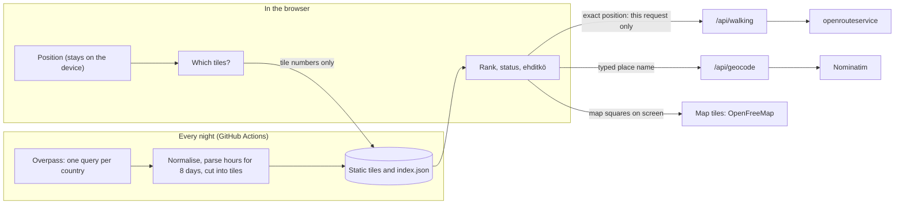

# Nearest pharmacy: build plan

Status: updated 22 Nov 2026; the build runs in Claude Code. M0 is built: sections 5, 6 and 10 record what the canvas and the M0 decisions settled (type sizes, the soon glyph, dark tokens, copy rules, the first-visit sky that follows the sun). After M0 the data architecture changed: pharmacies come from static tiles built by a nightly pipeline, not from live Overpass queries (section 7), with tests, CI and privacy checks to match (sections 7.6 and 12). The working name is **Auki** (Finnish for "open"); the final name is open again (decision D4) and lives in one constant. Design: Claude Design canvas "Auki: nettisivujen design" (private); board exports, source files and the start-screen illustration in `design/`. Claude Code may refine the design within the rules in `CLAUDE.md` and logs each decision in `DESIGN-LOG.md`. Scope decisions: section 4. On 24 Nov 2026 Janne widened the scope: medicine availability is in v1, as a hand-off to each country's own stock search (sections 4, 5, 7.6 and 7.9; `docs/research/medicine-availability.md`).

> Sections 2 and 8 summarise the findings of Treat's November 2026 field research: three people, 20 countries. Treat has confirmed that all of the trip's findings may be used and published (decision D1): the pharmacy findings, which the app shows as the field data of section 8, and what the trip's interviews taught, which is in section 2. The pharmacy evidence is in `docs/research/pharmacy-field-findings.md`. No person is named, and no field result is tied to a named pharmacy. Keep it that way in the app. (Pharmacy names in the designs are only examples.)

---

## 1. What we're building

A mobile-first web app that answers one question well: **which pharmacy near me can help me right now?**

It gets the user's location, reads nearby pharmacies from static tiles that a nightly pipeline builds from OpenStreetMap, and shows them on a map and in a list by walking distance with an honest open/closed status. For people abroad with a prescription from Finland, it also says what works in that country and gives them a card to show at the counter, in the pharmacist's language.

**Who it's for** (from the trip): Finns travelling or living elsewhere in Europe, internationals new to a country, and employees of multi-country companies. The moment of use: an unfamiliar city, often an evening or weekend, not feeling well, maybe a language barrier.

**Website first, iOS alongside.** The web app leads. The iOS app (SwiftUI, reading the same tiles) starts once the tile format and the shared test vectors exist, after M2 (decision D5).

**Not an official Treat product.** Footer line: "Janne Lapin työhakemusprojekti. Ei Treat Healthin palvelu." / "A job application project by Janne Lappi. Not affiliated with Treat Health." Treat's name and logo never appear in the app UI.

---

## 2. What the Treat trip taught us, and what we do with it

Findings from Treat's research trip of 3–13 November 2026: three people, 20 countries, one to six pharmacies per city. Rows 1 to 8 are the pharmacy findings: the evidence and how to read it are in `docs/research/pharmacy-field-findings.md`, and section 8.2 has the results per country. Samples are tiny, and most results are what staff said at the counter. Rows 9 and 10, and part of row 7, come from the trip's interviews. All of it is cleared for publication (decision D1). No one is named.

| # | Finding | Evidence (Nov 2026, small samples) | Decision |
|---|---|---|---|
| 1 | The nearest pharmacy is not always one that can help. | Three neighbouring pharmacies in Berlin gave three different answers to the same prescription. The Finnish e-prescription was found in 2 of 3 pharmacies in Warsaw and 0 of 3 in Prague. In Zagreb two of five couldn't find the system, and in Spain it was found once in eight. Practice varied even within one chain (Bratislava). | Sort by walking distance, but make open status and "what works here" visible at a glance. Every pharmacy offers "next nearest open". |
| 2 | Whether a prescription from Finland works depends on the country first, then the format. | The Finnish e-prescription works only in 8 countries (EE, LV, LT, PL, CZ, HR, PT, ES). A paper original with a wet-ink signature was accepted almost everywhere; Hungary also wants the doctor's stamp. A PDF on a phone was refused in most of the north (Tallinn 0/3, Warsaw 0/3, Prague 0/3, Frankfurt 0/4) and accepted in Vienna 4/4 and Milan 4/4; in Rome 3/3 would have dispensed. | Country data per country and per prescription format, built on public rules plus field results, each with sources and a checked date. v1 shows it as a banner and the counter card; full guides later. |
| 3 | The counter conversation is where it breaks. | Staff asked for an "insurance number" and didn't know that for Finland it's the personal identity code (Riga, Warsaw). One asked whether to search "from Finland or Europe" (Tallinn). The first answer was often no, and asking again helped (Zagreb); asking for the pharmacist fixed it (Warsaw). Staff English ranged from 1/5 to 5/5, and language was a barrier in Bratislava. | A counter card: full screen, in the local language with English below, saying exactly what to search and where the ID number is printed. Includes "Could a pharmacist help me?" One tip everywhere: if the first answer is no, ask for the pharmacist. |
| 4 | Systems go down, stock runs out and strengths differ. | Latvia's national e-health system was down for about an hour; none of the three pharmacies visited that afternoon could fetch any e-prescription. The prescribed medicine was out of stock in three pharmacies (Tallinn, Riga), and in Barcelona a traveller with a fever went through 7–8 pharmacies with no way to see who had it. Strengths differ between countries and pharmacists substitute (Budapest, Malta, Riga). | The guide mentions outages where they've happened. Every pharmacy detail has "Not in stock? Next nearest open". Counter-card lines for a different strength and for stock (section 8.3). Where a country has a stock search of its own, the app hands the question over to it (section 7.9): it says where to check, never that a pharmacy has a medicine. |
| 5 | Emailing the prescription to the pharmacy often works. | In Germany 8 of 11 pharmacies asked accepted a doctor's email (Munich 5/5). It was also accepted in Zürich 3/3, in Milan, by several pharmacies in Bratislava and by two in Ljubljana. In Zagreb it was the most reliable route: the pharmacy prints and stamps it. In Lisbon a PDF refused at the counter was accepted once emailed. Sometimes it didn't matter who sent it. Not allowed at all in Sweden, and refused 3/3 in Prague. | The pharmacy sheet shows the pharmacy's email from OpenStreetMap next to the phone. The counter card can ask "Can I email the prescription to you?" A prefilled email in the pharmacy's language comes later. |
| 6 | Some medicines that need a prescription in Finland are sold over the counter in Southern Europe. | Milder medicines were sold without checking in Spain (Barcelona 4/5, Málaga and Fuengirola 2/3), and the same was said in Italy, Greece and Malta. Antibiotics and strong medicines need a local doctor's prescription everywhere. | Never a tip to skip the prescription. The app says that some such medicines are sold over the counter there and that the pharmacist decides (section 8). The counter card can ask (section 8.3). |
| 7 | Nights and weekends are when it is hardest. | Practices closed at weekends sent people to the emergency room (Berlin). Copenhagen tells people to call 1813 first. There are 24/7 pharmacies in central Copenhagen (opposite the main station) and in Riga. A Finnish travel insurer told students where the nearest open doctor was. In many countries pharmacies take turns at night and on Sundays (public knowledge, verified per country in M6), and OpenStreetMap hours don't show whose turn it is. | A "nearest open now" line when nothing nearby is open, a 24-hour badge, the country's duty-pharmacy lookup where duty rotates (section 5), and 112. |
| 8 | Pharmacies differ in more than their hours. | Pharmacies with "International" in the name were more flexible (Munich, Vienna). Some vaccinate (Milan, Athens) or have a doctor on site (Malta). Some have Finnish-speaking staff (Tallinn, Costa del Sol). | No claims about a single pharmacy in v1 (section 4). A hint for international pharmacies is a candidate for later. |
| 9 | Language: the app in yours, the card in theirs. | Internationals screenshot Danish-only apps and ask ChatGPT what they say. Advice from a Nordic health-tech cluster: a health app has to be in the national language. | UI in Finnish and English. The counter card is in the language of the country the user is in, with the correct `lang` attribute. |
| 10 | Trust comes from restraint. | People disliked chatbots, wanted a fast route to a human, and worried about where their health data goes (Copenhagen, Berlin, Stockholm). | No chatbot, no accounts, no tracking, nothing stored on a server. Show sources and freshness. Link to official services instead of giving advice. |

---

## 3. Product principles

1. **Nearest that can help, not just nearest.** Distance sorts; status and country context decide.
2. **Render once, never jump.** The list appears complete and doesn't reorder under the user's eyes.
3. **Honest about uncertainty.** "Hours not listed", "Hours unclear", "Hours may be out of date", "Not field-tested", "Unreviewed translation" are first-class states.
4. **Your language on screen, theirs on the counter card.**
5. **Nothing stored on a server, almost nothing sent.** No accounts, no analytics, no cookies. Finding pharmacies sends no position at all: the browser works out which data tiles it needs and fetches those. The position leaves the device in one request only, for walking times, through our server. The device keeps the app and the last area's tiles so that it works offline, and nothing else. Section 7.6 lists every request, and a test fails the build if that list stops being true.
6. **Route, don't resolve.** No medical advice. Link to 112, national advice lines and Kanta.
7. **Fast.** Pharmacy data is static files on a CDN, fetched by tile. No hours parser and no UI kit in the browser. The map (MapLibre) is the one heavy dependency: load it after the first paint, and the list works without it. Budgets for initial JavaScript and mobile LCP are enforced in CI (section 12).
8. **Ask only when it matters.** No onboarding questions. Prescription details are asked abroad, when the user opens them.

---

## 4. Scope

Decided with Janne on 19–22 Nov: keep v1 small and do it well.

**v1:**
- First visit: one window, no questions (section 5). Returning users with location permission go straight to the map.
- Location → nearby pharmacies → map and list, sorted by walking distance (straight-line fallback, labelled).
- Opening hours: open now, closes soon, opens next, 24 hours, missing, unparseable, out of date (data older than 7 days is never shown as open).
- "Lähin auki nyt" card with "ehditkö" only when it tells something (section 5), and the next open pharmacy.
- Pharmacy sheet with route hand-off to Google Maps or Apple Maps, the pharmacy's own website and email when OpenStreetMap has them, and a link to correct the data in OpenStreetMap.
- Every state from section 7.3, each with a way forward. Place search when location is denied or unavailable.
- Abroad: "Resepti Suomesta?" banner (country status, one key tip and the field result for that country) and the counter card. Where pharmacies take turns at night, the country's duty-pharmacy lookup (section 5).
- Coverage: Finland and the twenty other countries of section 8. Elsewhere the app says so and hands off to a map app (section 7.7).
- Works offline for the area searched last (section 7.6).
- A short page that lists every request the app makes (section 7.6), and a data page with the pipeline's numbers per country (section 7.2).
- A hand-off link that another app can open with the country and the prescription format preset (section 7.8).
- Medicine availability (Janne's decision of 24 Nov 2026; until then "later", and Finland only): where a country has a stock search of its own, the app opens it from the card and from every pharmacy sheet, with the medicine's name in the link where the service's address takes one (sections 5 and 7.9). The app says where to check, and never that a pharmacy has a medicine. The name goes from the device straight to the service the user opens: never to our server, never stored (section 7.6). No scraping and no undocumented endpoints: a country joins only when its service can be linked to in the way its own search does.
- Finnish and English UI. Accessibility to the level in section 9.

**Later (designed as concepts on the canvas, not built in v1):** visit reports (always skippable, anonymous), full country guide pages, doctor's-email helper, before-you-travel checklist, guide for internationals in Finland, share link.

**Later, from the field findings:** a prefilled email to the pharmacy in its language; a hint for pharmacies with "International" in the name.

**Alongside the web app:** the iOS app, on its own track from M2 on (section 11, decision D5). SwiftUI, reading the same static tiles. Showcase: ehditkö as a Live Activity.

**Later, already decided:**
- Live stock in the app itself, per pharmacy: only through an API that a country's service has agreed to. The seam for it is built (one provider per country, section 7.9) and shown in `/dev/states` on example data; nothing of it is in the live app.

**Not doing:**
- Our own medicine stock or price data (no source for it; prescription prices are the same in every Finnish pharmacy anyway). For stock the app hands over to each country's own service (v1, above).
- Doctor, chat, triage or routing to clinics (that's Treat's product, not this app's).
- Reviews or ratings from Google on our map (Google's EEA terms don't allow Places content with a map; link to Google Maps instead).
- Storing prescriptions or ID numbers. The app tells people where their ID number is printed; it never asks for it.
- Accounts, a database, a chatbot or any LLM feature, scraping stock or prices, push notifications, Android before iOS is done. Each adds work without changing what a reviewer learns about the engineering.
- Per-pharmacy claims about cross-border capability in v1. Samples are too small and answers depend on the staff member (Prague: pharmacies on the official list of those that have dispensed foreign e-prescriptions still said no). Later, visit reports can show dated user experiences with sample sizes.

---

## 5. Screens and flows

Visual reference: the canvas, board exports in `design/png/` and the source files in `design/canvas/` (exact colours, sizes and copy; see `design/README.md`). The canvas is the approved direction, not a pixel spec: refine it where real data, accessibility or clarity call for it, within the rules in `CLAUDE.md`. Canvas sample data: OpenStreetMap, Helsinki on a Thursday at 20:41, Riga on a Friday at 23:40, times simulated. Pharmacy names in the designs are only examples.

### First visit: one window
- A sky gradient with the skyline at the bottom: a city with one lit pharmacy cross. The sky follows the sun (section 6, "First-visit sky"). The canvas dusk (`#0E2652` → `#1E417F` → `#2F5CA6` → `#8BBAEC` → `#E3EEF6` → `#F6D4BD`) is its twilight look and the fallback without JavaScript. The skyline is `design/skyline.svg` drawn as an inline SVG component, so its colours can follow the sky. Wordmark top left, "In English" / "Suomeksi" top right.
- Headline: "Löydä lähin auki oleva apteekki" / "Find the nearest open pharmacy". Keep "open" in it: open-now is what generic maps don't answer well.
- Primary button "Näytä apteekit lähelläni" / "Show pharmacies near me" → the browser's location prompt → results. Secondary text button "Hae paikan nimellä" / "Search by place name".
- Nothing else on this window, apart from the footer line kept small and quiet. Phone: both actions sit in a dark band at the bottom that continues the street, with the footer line under them; desktop: left-aligned text block, buttons inline, footer on the street.
- While locating, the button gives way to a status line of the same size; nothing else moves.

### Results: map first
- **Phone:** full-screen map. Floating bar on top: app mark, place and how many are open ("2 auki klo 20.41"), refresh, language. Bottom sheet, with three places to rest (provisional, `DESIGN-LOG.md` 24 Nov 2026; until then it had two, and a collapsed answer of three lines and two buttons):
  - at its lowest (default): the handle and one row: the cross, the name, the distance and the status, and one button ("Reitti"; "Soita" where the nearest pharmacy's hours are unknown; "112" where nothing is open). The map has the screen;
  - at the card: the full card (below) and "Kaikki 8 apteekkia"; never more than 60 % of the screen;
  - open: the card and the list, up to just under the bar.
  - The sheet moves by its handle (one place up at a time, and from the list back to the row), by "Kaikki 8 apteekkia" and by dragging: it follows the finger between its three places and settles on the nearest, or one place the way it was thrown. Below the open list the whole sheet is the handle; open, only the handle is, so the list scrolls. With nothing open the sheet starts at the card.
- **Desktop:** list panel on the left (about 440 px), map on the right. The panel shows every result and scrolls; nothing is hidden behind a "show all" button. Map overlays: legend (Auki / Sulkeutuu pian / Kiinni) top left, zoom and locate bottom right, the map credit bottom left (OpenFreeMap, OpenMapTiles and OpenStreetMap, as the tile host asks). Locate brings the dot back to the middle; it does not search again.
- **Markers:** open or closing → a capsule with the cross and the walking time; closed → a small unlit disc without a time; hours missing → dashed cross. The selected pharmacy is larger, with a ring and, on desktop, its name on a small plate. At night only open pharmacies glow. An open pharmacy outside the view gets an edge chip with an arrow and its walking time: on the edge, on the line towards it, for at most the three nearest. Markers are real buttons over the map, in the order of the list for a keyboard.
- **Every pharmacy, not only the list's ten** (provisional, `DESIGN-LOG.md` 24 Nov 2026). The list and its markers are the nearest ten. Every other pharmacy on the tiles the device holds is on the map as a small sign that the map draws itself, as one layer, in the list's four shapes: a lit disc for open and for closing soon, an unlit one for closed, the dashed cross where the hours aren't known. No distance and no glow: those belong to the ten.
  - Where signs would lie on top of each other the map leaves some out, the open ones last, so a whole city stays readable.
  - A press on a sign opens the same pharmacy sheet, and that pharmacy has a marker like the list's while it is selected.
  - Moved by hand to a new area, the map asks for the tiles of the squares it now shows: squares of the map the user is looking at, never the position (section 7.6). A view of more than twelve squares is too far out and asks for nothing. A move the app makes itself (framing the results, following a walk) asks for nothing.
  - Without MapLibre only the ten are drawn. For a keyboard or a screen reader the pharmacies are the list: one beyond the ten is reached by searching its place.
- **Touch.** Every touch on the map is the map's own, in every state: before MapLibre has arrived, while it draws, and when it couldn't start (`touch-action: none` on the whole map, so a pinch never zooms the page). A drag or a pinch that begins on a marker moves the map like one that begins beside it: once MapLibre is drawing, the markers live inside the element it listens on. One finger moves the map, and it glides on when thrown; two fingers zoom around themselves; two taps come closer and a tap with two fingers goes back out. While the map moves, positions are written straight to the markers and the chips and nothing is rendered again; a new sun changes colours and the light, not the style.
- **The first view:** the position in the middle of what the bar and the sheet leave free, wide enough for the nearest five, and closer when the pharmacy in the card is only a block away, so that its marker and the dot stand apart.
- **You are here:** cobalt dot, white ring, and a halo as wide as the accuracy the device reports. It follows the user while the page is visible (section 7.1, step 11).
- **When the map can't be drawn** (no WebGL, or the map tiles don't arrive): the markers, the dot and the edge chips stay, on the plain ground colour, and one line says the map didn't load. The list never depended on it.
- **Route:** the walking route to the selected pharmacy, cobalt on a white casing by day, sky blue on its own glow in the dark. It is a layer of the map, over the streets and the roofs and under every name and marker, and it runs from the dot to the marker.
  - Unasked, it leads to the card's pharmacy while that one is open and a walk reaches it in time: the line is the card's "Reitti" on the map. A pharmacy selected from the list or the map gets its own line, open or not.
  - Only for the list's ten, within 3 km, and only when walking times came: without them the app says "linnuntietä" and draws no walk. Only where MapLibre is drawing.
  - One request per pharmacy and position (section 7.1, step 7). A line that doesn't come is simply not there: the route hand-off in the sheet never depended on it.

### "Lähin auki nyt" card
- Name, address, walking time (the largest number), distance.
- "Ehditkö" only when it tells something:
  - closes within 60 minutes → a timeline: "Perillä 20.44", "Sulkeutuu 21.00", "16 min pelivaraa". The slack is green, and turns to the `soon` colour when it is under 5 minutes or under 20% of the walking time, whichever is larger;
  - arrival would be at or after closing → "Et ehdi ennen sulkemista" and the next open pharmacy, which gets "Reitti" and "Soita" as the main actions. The closing one keeps "Soita": a call can ask them to wait. On the phone the sheet's row says the same and its button is "Soita";
  - the next open pharmacy is one a walk still reaches before it closes. When the only open pharmacies nearby close before a walk there would end, the wider search of section 7.1 runs as if nothing were open, and the farther open one is the next: without a walking time, and beyond 3 km with a button that promises a route, not a walk;
  - otherwise (later closing, 24 h) → only the status line ("Auki klo 24 asti", "Auki ympäri vuorokauden").
  - No "you'll make it" badge: it's almost always true.
- Actions: "Reitti", "Soita"; abroad also "Näytä apteekissa" (counter card).
- "Ei varastossa? Seuraava auki: Yliopiston apteekki, 5 min, auki klo 24 asti."
- "Etsitkö tiettyä lääkettä? Tarkista saatavuus": right under the line above, as its second line, in a country that has a stock search of its own ("Medicine availability" below; provisional, `DESIGN-LOG.md` 25 Nov 2026). Every form of the card carries it: where there is no "Ei varastossa?" line it is the card's last section, and with out-of-date data, where a notice has the card's place, it stands under the notice.
- When nothing nearby is open:
  - If the wider search finds a pharmacy that is open now within 30 km (section 7.1), it leads as "Lähin auki nyt", like the open one on the Riga board: its straight-line distance instead of a walking time, its city when that isn't the place named above the results, and the route hand-off. Beyond 3 km in a straight line the route is no longer offered as a walk: the links name no way of travel and the map app picks one. "Avautuu ensimmäisenä" sits below it in the same card: the nearby pharmacy that opens first. The other closed ones fold into "Kiinni nyt". On the phone the sheet's row carries the far one; "Avautuu ensimmäisenä" is in the card.
  - If that search finds nothing either, the card is "Avautuu ensimmäisenä" alone, without a route button, and keeps "Hätätilanteessa soita 112" prominent. On the phone the sheet then starts at the card; pulled down to the row, the row's button is 112.
- **Hours missing nearby (provisional, `DESIGN-LOG.md` 23 Nov 2026).** In Southern Europe most pharmacies have no opening hours in OpenStreetMap (Greece 7 %, Spain 18 %, Italy 23 %), and the app never guesses them. So the card must not send people past such pharmacies to a far one whose hours are known:
  - When more than half of the pharmacies nearer than the nearest one known to be open have hours the app can't read (missing, unparseable or uncertain), and that one is more than 500 m farther than the nearest of them, the nearest of them leads as "Lähin apteekki", with its own status line. The card says how many nearby pharmacies it is true of, puts "Soita" first, and keeps the one known to be open as one line: "Lähin, jonka tiedetään olevan auki: …". One small line gives the country's share of pharmacies with hours and leads to the data page.
  - The same when no pharmacy is known to be open: then 112 stays prominent, and neither the heading nor the card says that nothing is open.
  - In this case the heading and the phone's bar don't count open pharmacies: "Lähimpien apteekkien aukioloaikoja ei tiedetä".
  - Where the open one is at most 500 m farther, it leads as before, and one line says how many nearer pharmacies have hours the app can't read.
  - Where night duty rotates, the duty lookup of M6 joins this card under the line of the one known to be open.
- **Rotating night duty.** In many countries (Germany, Austria, Italy, Spain and Greece among them) pharmacies take turns at night and on Sundays, and OpenStreetMap hours don't show whose turn it is. So where `duty` is `rotating` (section 8.1), "nothing open nearby" can be wrong:
  - When nothing nearby is open, the country's duty lookup leads the card, above the farther open pharmacy and "Avautuu ensimmäisenä": "Tämän yön päivystävä apteekki" with the official lookup (a link or a phone number), and one line on why our list may miss it.
  - When we do show an open pharmacy while the nearer ones are closed, our answer stays first and the lookup is one line under it. An external link shouldn't push a pharmacy we know is open out of the first place.
  - The trigger is the state (the nearer pharmacies are closed), not the clock, so Sundays and public holidays are covered too.
  - Where there is no national lookup, the line says what holds in most of these countries: a closed pharmacy posts the duty pharmacy on its door. Each claim and source is verified in M6.
  - Finland and the other countries with fixed long-hours pharmacies show nothing of this.
  - It changes the layout of the card, so it goes through `/dev/states` first.

### List
Rows: glyph, name (plus the street when names repeat, e.g. three "Benu"), status line, walking time and distance. The order is by walking time, which is what the rows lead with; a pharmacy with no walking route comes last, with its straight-line distance. When walking times didn't come the order is by straight line, and the list's heading and the footer say so. At night, when the nearest are all closed, they fold into one plain row, "Kiinni nyt", with the count and when the first one opens.

### Pharmacy sheet (tap a marker or a row)
Name, address, status, walking time and distance; hours for the coming seven days with equal days grouped ("Joka päivä 8.00–24.00", "ma–pe 8.00–21.00"), so a public holiday shows as the exception it is (from the tile's intervals, on the pharmacy's clock, Monday first; an opening past midnight is said on the day it begins; a day the data calls unknown reads "ei tiedossa", and a day beyond the data's window is left out); accessibility from `wheelchair` and `wheelchair:description`; phone; the pharmacy's email (`email`, else `contact:email`) as a `mailto:` link, because emailing the prescription often works (section 2); the pharmacy's own website when OpenStreetMap has one (`website`, else `contact:website`), shown by its host name. Actions: "Reitti Google Mapsissa", "Reitti Apple Kartoissa", "Soita". Footnote: the route opens in the map app and the link carries only the pharmacy's position; data from OpenStreetMap, with `check_date` when present, and "Väärät tiedot? Korjaa OpenStreetMapissa": a link to OpenStreetMap's note form at the pharmacy's position. When the hours are missing or unclear, the same link sits next to the status line. A fix reaches the tiles the next night, with no backend of ours. Under "Ei varastossa? Seuraava auki: …" the sheet has the same line as the card, "Etsitkö tiettyä lääkettä? Tarkista saatavuus", when the pharmacy's country has a stock search of its own.

### Medicine availability (provisional, `DESIGN-LOG.md` 25 Nov 2026)
The app does not know what a pharmacy has in stock, and says so. It says where to check: the country's own service (section 7.9).
- **The line** "Etsitkö tiettyä lääkettä? Tarkista saatavuus" in the card and in every pharmacy sheet. It asks nothing until it is pressed (section 3, principle 8), and it is not there in a country without such a service.
- **The dialog** "Tarkista lääkkeen saatavuus": the whole screen on the phone, so the keyboard never covers the field; a card in the middle on the desktop. In order:
  - one or two sentences that name the service and who runs it, or say that the country has no stock search across all pharmacies and what the link leads to instead; under them, quieter, what limits the service: that not every pharmacy takes part, or that its app is not in the Finnish App Store, with the date that was checked;
  - the field "Lääkkeen nimi", only where the service's address can carry a name, with the service's own hint on what it searches by;
  - the link, named after where it leads ("Avaa apteekki.fi"), with the mark of a link that leaves the app. It opens in a tab of its own, so the results stay as they were. The keyboard's "go" follows it;
  - what is sent: "Nimi siirtyy laitteeltasi suoraan sivustolle apteekki.fi, kun avaat linkin. Sitä ei lähetetä tämän sovelluksen palvelimelle eikä tallenneta." Where there is no field: that the name is typed into the service's own search, and that this app neither asks for it nor sees it;
  - "Varastotieto on palvelun oma, eikä tämä sovellus näe sitä. Varmista apteekista ennen kuin lähdet."
- The country is that of the pharmacy the line was pressed on: the card's pharmacy, or the sheet's.
- No medicine is named anywhere in the app's own texts, not even as an example in the field: that would read as advice.
- The name is gone when the dialog closes.

### Abroad
- "Resepti Suomesta?" only outside Finland, as a section of the card (one surface, not a card of its own): the country status in one line ("Suomalainen e-resepti toimii Latviassa passilla"), the key tip ("insurance number" = the personal identity code on the passport's data page), the field result for that country with its sample size, month and city, never a pharmacy's name ("Kokeiltu Riiassa 11/2026: e-resepti löytyi 1/1 apteekista"), and the source with the date it was checked. The field line is new to the card: its wording and place go through `/dev/states` in M6.
- Counter card: full-screen dialog; the local language large, English below; e-prescription / paper switch; "Could a pharmacist help me?"; "Unreviewed translation" badge where it applies; screen kept awake. Always light, also in dark mode: a stranger reads it at arm's length in a lit pharmacy, like a paper document. Offered from the card and from every pharmacy sheet.

### Place search (no location)
Same sky as the first visit. A search field and "Hae". Every location problem (denied, unavailable, timeout, unsupported) lands here with a note that starts with a heading. When location is blocked: "Sijainti on estetty tältä sivulta. Voit sallia sen selaimen asetuksista." and "Näin sallit sijainnin". A search that finds no place says which name it looked for and keeps it in the field; a failed lookup and a missing connection each say so.

### Data that is out of date
The results footer always says when the data was fetched ("Tiedot: OpenStreetMap, haettu 22.11."). When it is more than 7 days old, nothing is shown as open: every pharmacy gets the dashed cross and "Aukioloajat voivat olla vanhentuneet", a notice takes the place of the "Lähin auki nyt" card, and the list stays in distance order. Built in M3 (`/dev/states/stale`): the notice gives the date of the data and says to call before going; the heading no longer counts open pharmacies; on the phone the sheet is open from the start. The footer's data date is followed by a link to the data page, "Tietoa aineistosta".

### Outside the covered countries
Section 7.7.

### What the app sends
A short text page, linked from the footer sentence "Sijaintiasi ei tallenneta.": every request the app makes, what it carries and who receives it, and what the device keeps for offline use (section 7.6).

### The data
A short page, linked from the data date in the results footer: per country the number of pharmacies, the share with opening hours, the parse rate and the date and time of the country's last successful fetch, read from `index.json` (section 7.2). Above the table: when the last run was; a country that run could not refresh says so in its row. The page also says what a low share with hours means for the results (section 5, "Lähin auki nyt" card). The pipeline's quality is the core of the app, so it is shown, not claimed.

### Offline
Abroad, people are often without data or with weak signal indoors. After one visit the app opens without a connection and answers from the tiles of the area searched last, with the date of the data and straight-line distances. The counter card works offline too. The map may be blank; the list doesn't need it.

### States
Section 7.3. Every state has a way forward.

---

## 6. Design system

### Concept: the lit cross

Across Europe, people find a pharmacy at night by looking down the street for the lit green cross. The app uses that signal: **a lit cross means open**. It's the one bold element, used for status, map markers and the app mark. On the map it is the only green: parks are muted. Everything around it stays quiet. The brand atmosphere comes from Treat's blues (cobalt → sky → ice) and the peach warmth, used on the first-visit dusk scene and in dark mode.

Review against generic defaults:
- Dark mode is deep navy with mint crosses, which is close to the "near-black plus acid green" cliché. We keep it because the green is semantic (the real pharmacy sign) and appears only on status glyphs. The accent for actions stays in the cobalt family: cobalt in light, sky `#8BBAEC` with navy text in dark, because cobalt on navy is 2.8:1 and fails 3:1.
- No identical rounded cards with grey shadows: results are one surface with hairline dividers.
- No all-caps eyebrows, no middle-dot meta strings, no monospace data labels, no arrows on buttons.

### Colour

Light:

| Token | Hex | Use | Contrast |
|---|---|---|---|
| `ink` | `#0B1B31` | Text (Treat's ink) | 16.2:1 on `paper` |
| `ink-2` | `#45556E` | Secondary text | 7.1:1 |
| `meta` | `#56657D` | Tertiary text | 5.5:1 |
| `paper` | `#F4F8FC` | Ground | |
| `surface` | `#FFFFFF` | List, dialogs | |
| `hair` | `#D5DFEA` | Borders of cards and lists (decorative) | |
| `hair-2` | `#E3EAF2` | Dividers inside a surface (decorative) | |
| `outline` | `#C5D1DF` | Outline of secondary buttons and inputs | decorative; the label carries the contrast |
| `quiet` | `#EEF3F8` | Quiet fills: close button, segmented control | `meta` on it 5.3:1 |
| `cobalt` | `#2F5CA6` | Primary buttons, links | white on it 6.6:1; as text 6.2:1 |
| `cobalt-deep` | `#244C8F` | Pressed | white on it 8.4:1 |
| `sky` | `#8BBAEC` | Glow gradient | decorative |
| `ice` | `#E3EEF6` | Glow gradient, selected row | `ink` on it 14.7:1 |
| `peach` | `#F6D4BD` | Glow gradient (warm edge) | `ink` on it 12.4:1 |
| `open` | `#0D6E4F` | "Open" text | 5.9:1 |
| `open-glyph` | `#0F8F63` | Lit cross | 3.8:1 (non-text ≥ 3) |
| `soon` | `#8A5A06` | Closes soon, uncertain (text and glyph outline) | 5.6:1 |
| `soon-tint` | `#FCEFD6` | Badge and notice background | `soon` on it 5.2:1 |
| `track` / `track-soon` | `#9AD5BC` / `#ECD29A` | Ehditkö timeline, and the same when the slack is tight (decorative; the times and the slack are text) | |
| `closed-glyph` | `#6B7990` | Unlit cross outline | 4.1:1 |
| `error` | `#B42318` | Errors (Treat's) | 6.2:1 |
| `soon-fill` | `#F2B544` | Closing-soon glyph fill and marker capsule, with `#3D2A00` text (7.5:1) | |

Dark (`prefers-color-scheme: dark`):

| Token | Hex | Contrast |
|---|---|---|
| `night` | `#071427` (Treat's ink0) | ground |
| `night-surface` | `#0E2342` | cards and lists |
| `night-sheet` | `#0B1D38` | phone sheet |
| `text` | `#EAF1F8` | 16.2:1 |
| `text-2` | `#A9B8CC` | 9.2:1 |
| `meta` | `#8FA2BC` | 7.1:1 on `night`, 6.0:1 on `night-surface` |
| `hair` / `hair-2` | `#1D3A63` / `#1A3356` | borders / dividers (decorative) |
| `outline` | `#2E4C78` | control outlines (decorative) |
| `quiet` | `#16305A` | quiet fills; `text` on it 11.5:1 |
| `selected` | `#14315C` | selected row; `text` on it 11.4:1, `meta` 5.0:1 |
| `action` | `#8BBAEC` with `#071427` text | primary buttons: text 9.1:1, fill against `night` 9.1:1 |
| `lit` | `#3DDBA0` + soft glow | 10.4:1 |
| `open-text` | `#6EE7B7` | 12.1:1 |
| `soon` | `#F2B544` | 10.1:1 (text, and the glyph with a soft glow) |
| `closed-glyph` | `#7487A5` | 5.1:1 on `night`, 4.3:1 on `night-surface` (non-text ≥ 3) |
| `link` | `#8BBAEC` | 9.1:1 |
| `error` | `#FF9D91` | 9.2:1 on `night`, 7.8:1 on `night-surface` |
| `track` / `track-soon` | `#2A7F66` / `#7A5F1F` | decorative |

Each token is defined once in `app/globals.css` with `light-dark()`. The theme follows the device (`color-scheme: light dark`), never the clock; `data-theme="light"` or `"dark"` on any element overrides it for review.

Colours sampled from treat.health's CSS tokens and Treat's LinkedIn banner and logo tile. There is no brand book, and the app doesn't present itself as Treat's, so the sampled palette stays (decision D3). All contrast figures computed (WCAG 2.x).

Map style (MapLibre, custom; values from the canvas). The look comes from our own style (`lib/map/style.ts`, built from these tokens), not from the tile host's ready styles. The spike (section 11, S1) showed it on real tiles in three variants, and Janne chose from them: top-down only, flat and calm at overview zooms, and from about zoom 15 buildings in 3D, lit from the side the sun is really on. No pitched camera and no sky on the map. Built in M4 (`/dev/map` shows it on real tiles at three moments in both themes):

- **Buildings** rise between zoom 15 and 15.6, from nothing to their own height. With the sun up the light comes from its real direction; after sunset it is dim and from straight above.
- **The sun and the theme (provisional, `DESIGN-LOG.md`).** The device theme picks light or dark, as everywhere else: the sun never changes the theme. It moves the light on the buildings, and in the dark theme it sets how deep the dark is: the dusk column while there is light in the sky (the sun above −4°), the dark column once it is gone (below −8°), and steps between. So the light theme is the light column at any hour, and the dark theme is never lighter at night than by day.

| Layer | Light | Dark, light in the sky (dusk) | Dark, night |
|---|---|---|---|
| Land | `#EBF0F5` | `#1B3763` | `#0A192E` |
| Water | `#B9D2EA` | `#0D2450` | `#030C1A` |
| Parks (muted, never status green) | `#DCE7E0` | `#1A3D62` | `#0B1F31` |
| Buildings / edge | `#DEE5ED` / `#D2DBE5` | `#234273` / `#2B4B7F` | `#0F2240` / `#132948` |
| Major roads / casing | `#FFFFFF` / `#C2CEDC`, 8.5 px | `#4668A2`, 7.5 px | `#28456E`, 7.5 px |
| Minor roads / casing | `#FFFFFF` / `#D3DCE7`, 4.2 px | `#31528A`, 3.8 px | `#1A3254`, 3.8 px |
| Paths | `#FFFFFF`, 1.3 px | `#2C4B80`, 1.2 px | `#18304F`, 1.2 px |
| Street labels / halo | `#55657D` / land | `#A9BAD3` / land | `#7B8FAC` / land |
| Route (M5) | `#2F5CA6` 5.5 px on a white 10 px casing | `#8BBAEC` 5 px with a blurred 14 px glow | the same |

Markers, made stronger in M4 (provisional, `DESIGN-LOG.md`): every marker stands on a 2 px ring in white (dark: `#071427`), which keeps streets and roofs from running into it. Open capsule 30 px tall, `#0D6E4F` with white cross and text (dark: `#3DDBA0` with `#03241A` and a mint glow); closing soon `#F2B544` with `#3D2A00`; closed disc 25 px, white with a `#93A1B5` ring and a `#6B7990` outline cross (dark: `#132C52`, `#5A7096`, `#7487A5`). You-are-here `#2F5CA6` (dark `#5B8DEF`), white ring, halo at 14 % and at least 64 px wide, under every marker.

### First-visit sky

The sky on the first visit and the place search follows the sun, not the clock (`lib/sky.ts`). The map views stay on the light and dark themes: there the sun moves only the map's light and, in the dark theme, its depth ("Map style" above).

- Sun altitude is computed for an approximate position taken from the device time zone (a table of European zones, Helsinki as fallback). No location permission and no network request.
- Four looks, blended linearly by sun altitude between the altitudes where each is at full strength. Helsinki is dark by 16.00 in November and still light at 23.00 in June.
- Windows follow the local clock: few lit from 00.30 to 05.30, many from 16.00 to 23.00, some otherwise. The pharmacy cross is always lit.
- The first three gradient stops sit behind white text and each keeps at least 4.5:1 against it, in every look and every blend (unit-tested).
- An inline script in `<head>` picks the look before first paint. Nothing animates. Without JavaScript the twilight look stays. `/dev/states` and the tests use fixed moments.

| Look | Full strength at | Sky, top to horizon | Far / near buildings |
|---|---|---|---|
| Night | −12° and below | `#040B1C` `#081530` `#0D2147` `#132D5C` `#1A3A70` `#22477F` | `#14294F` / `#071223` |
| Twilight (the canvas dusk) | −4° | `#0E2652` `#1E417F` `#2F5CA6` `#8BBAEC` `#E3EEF6` `#F6D4BD` | `#3E5F96` / `#0B1B31` |
| Golden hour | +2° | `#17386F` `#2A55A0` `#3F6DB5` `#D8C4C8` `#F6D2B4` `#F9B98A` | `#6E86B4` / `#10223F` |
| Day | +12° and above | `#1B4F9E` `#2560B4` `#2F6FC4` `#86B7EA` `#CFE4F7` `#EDF5FB` | `#8FA9D2` / `#1C3357` |

### Type

- **Atkinson Hyperlegible Next**, variable (weights 200–800), self-hosted with `next/font`, subsets `latin` + `latin-ext` (about 53 KB of woff2 together). It was designed by the Braille Institute for low-vision readers: distinct I/l/1 and O/0, which matters for house numbers, times and a card read by a stranger at arm's length. Verified to cover every counter-card language (Baltic, Polish, Czech, Croatian, Nordic, German, Portuguese and Spanish characters) and to support tabular figures. It has no Cyrillic, so no Russian on the card in v1.
- One family. Hierarchy comes from size and weight only.
- Sizes as on the canvas, 17 px base, set in rem: 13.6 · 14 · 15 · 16 · 17 · 21 · 26.5 · 33, and 42 to 60 for the first-visit headline. Body 17/1.5.
  - Pharmacy name: 21/1.2 at weight 650 in the card and the sheet, 17/1.3 in rows.
  - Walking time: 33 at weight 750 in the card, 21 at 700 in rows.
  - Timeline times: 26.5 at 700.
  - Counter card: 29/1.27 at weight 650 (32 on desktop), follow-up line 22/1.32.
- `font-variant-numeric: tabular-nums` on all times and distances. Default tracking, except the slight tightening the canvas uses on display sizes (−0.02em headline, −0.015em large numbers, −0.01em titles). Don't tighten body text the way Treat tightens Geist.
- Line length under 70 characters.

### Shape, space, elevation

- 4 px base: 8 / 12 / 16 / 24 / 32 / 48.
- Radius hierarchy: list container 20, dialogs and sheets 28 (top corners), buttons 12 (14 for the large first-visit buttons), chips 10, status badges and map capsules round. Rows inside the list: 0.
- Buttons are rounded rectangles without shadows. Icons in buttons only where they carry meaning (walking route, call). Pill buttons, icon-plus-shadow call-to-actions and FI/EN pill toggles read as generic in review and were dropped.
- No shadows on rows. One shadow for dialogs only.
- Touch targets ≥ 44 px.

### The cross glyph

A plus with rounded terminals, arms equal, 20 px in the list.
- Open: filled `open-glyph`. In dark mode, `lit` with a soft glow.
- Closes soon: filled `soon-fill` (amber) with a 1.3 px `soon` outline. The outline is what keeps it at 3:1 on white. In dark mode amber with a soft glow.
- Closed: 1.75 px outline in `closed-glyph`.
- Hours unknown: dashed outline. Also used when the hours can't be parsed or are uncertain; uncertain ones get `soon`-coloured text. There is no fifth glyph.

The shape differs for each state, so colour is never the only signal, and the status text always sits next to it. Custom SVG, no icon library. Other icons (directions, phone, walking person) are drawn in the same 1.75 px rounded stroke.

### Motion

- One orchestrated moment: when results render, the crosses of open pharmacies switch on in order, on the map and in the list, 30 ms apart, each 180 ms (opacity plus glow). It shows the answer, which ones are open, rather than decorating.
- Expand/collapse and dialog open: 200 ms, user-triggered only.
- `prefers-reduced-motion`: no stagger, no glow animation.

### Copy

- Sentence case, plain verbs, no exclamation marks, no em dashes.
- Times, distances and dates via `Intl` in the UI language.
  - Finnish: "klo 20.45"; whole hours as "klo 21" in status lines, both times in full where two are compared ("20.44 … 21.00"); ranges with an en dash and no spaces ("8.00–24.00", "ma–pe"); decimal comma ("1,1 km"); a non-breaking space between a number and its unit ("3 min", "220 m") and after "klo"; quotation marks ”…”; `hyphens: auto` on Finnish text.
  - English: en-GB, 24-hour times ("21:00", "09:00"), "1.1 km"; closing at midnight reads "Open until midnight".
- Each action keeps its name through the flow.
- Errors say what happened and what to do next. They don't apologise.

| Situation | FI | EN |
|---|---|---|
| Open | Auki klo 21 asti | Open until 21:00 |
| Closes soon (< 30 min) | Sulkeutuu pian, klo 17.45 | Closes soon, 17:45 |
| Closed | Kiinni, avautuu huomenna klo 9 | Closed, opens tomorrow 09:00 |
| 24 h | Auki ympäri vuorokauden | Open 24 hours |
| Missing | Aukioloaikoja ei ole merkitty | Hours not listed |
| Unparseable | Aukioloajat epäselvät: ”…” | Hours unclear: “…” |
| Uncertain | Aukioloajat epävarmat (”…”) | Hours uncertain (“…”) |
| Out of date (data older than 7 days) | Aukioloajat voivat olla vanhentuneet | Hours may be out of date |
| Ehditkö, timeline | Perillä 20.44 · Sulkeutuu 21.00 · 16 min pelivaraa (three separate labels) | Arrive 20:44 · Closes 21:00 · 16 min to spare |
| Ehditkö, too late | Et ehdi ennen sulkemista. Seuraava auki: … | You won't make it before closing. Next open: … |
| First visit | Löydä lähin auki oleva apteekki | Find the nearest open pharmacy |
| Location button | Näytä apteekit lähelläni | Show pharmacies near me |
| Place search | Hae paikan nimellä | Search by place name |

### Taken from Treat, and left behind

- **Taken:** the navy ink, the cobalt-sky-ice blues and the peach warmth, the amber and red notice tones, the calm and direct voice.
- **Left behind:** lifestyle photography, the glass nav bar, Geist and Inter, pill buttons, the marketing-page structure, the logo and the name.

---

## 7. Architecture

Next.js 16 (App Router; Node.js 20.9 or later), TypeScript, CSS Modules with CSS variables. No Tailwind, no UI kit. Deployed on Vercel. The pipeline is TypeScript that Node runs as it is, without a build step, which needs Node 22.18 or later; `package.json` is an ES module for that reason.

Three parts:

- **A nightly data pipeline** (GitHub Actions) turns OpenStreetMap's pharmacies into small static files, the tiles. Nothing in the app queries Overpass.
- **A static site** that reads the tiles. Ranking, opening status and ehditkö all run in the browser, from the position on the device.
- **Two thin server routes** for what can't be worked out ahead: walking times (openrouteservice) and place search (Nominatim).



Map: MapLibre GL JS with a custom style (section 6) on OpenFreeMap vector tiles: free, no key, no cookies. OpenFreeMap's public instance is provided as is, so the address of the tiles is config (`NEXT_PUBLIC_MAP_TILES_URL`, a TileJSON address; the style is our own and stays), and the README documents the fallback: a second provider with the same schema or self-hosted tiles, switched by that one value. The allowed host in `lib/requests.ts`, and with it the Content-Security-Policy, follows from it (decision D6, closed). Markers, the name of the selected pharmacy, the edge chips and the you-are-here dot are our own HTML over the map's canvas, so they share the list's components and focus handling. They are placed by the same arithmetic with MapLibre or without it (`lib/map/camera.ts`): when the map can't be drawn they stay where they were, on the plain ground colour. The pharmacies beyond the list's ten are the exception: a city square can hold a thousand, so the map draws them itself, as one symbol layer on a GeoJSON source (`lib/map/area.ts`, the layer in `lib/map/style.ts`, the signs in `components/mapSigns.ts`). MapLibre itself is fetched only once results are on screen.

### 7.1 Data flow

1. **Page:** prerendered static shell per locale (`/fi`, `/en`; `/` redirects by `Accept-Language`). The client checks geolocation support, HTTPS and permission state (Permissions API where supported). If permission is already granted, search starts; otherwise wait for the button.
2. **Locate:** `getCurrentPosition` with low accuracy, `maximumAge` 5 min, `timeout` 10 s. The timeout doesn't count the time spent on the permission prompt, so an ignored prompt never calls back: after 8 s, show "waiting for permission" with the place-search option. If accuracy is worse than about 1 km, show "Your location is approximate" with place search.
3. **Tiles:** from the position the client works out which tiles it needs (section 7.2) and fetches them in parallel from our own origin, together with `index.json`. The requests name squares of 20 to 30 km. The position stays on the device.
   - Candidates: the nearest 20 pharmacies in a straight line within 10 km. If there are none, the nearest five within 50 km. If there are none there either: "None found".
   - The client keeps loading neighbouring tiles until no tile it hasn't loaded could hold a nearer pharmacy. `index.json` says which tiles exist, so empty squares cost nothing.
   - The map shows every pharmacy on the tiles loaded this way. When the user moves the map to an area whose squares aren't on the device, the client fetches those too: at most twelve squares a view, which squares follows from what the map shows, and nothing is fetched for a move the app made itself. A square that doesn't load is left empty on the map and changes no answer of the search.
4. **`POST /api/walking`:** the client sends the position, rounded to five decimals (about a metre), and the candidates' positions: `{ from, to: [...] }`. The server calls the openrouteservice Matrix API (foot-walking, one request, key server-side) and answers with one walk per candidate, metres and seconds, or null where there is no walking route. This is the only request that carries the position.
   - Responses are `no-store` and nothing is logged. The position is in the body, never in the address.
   - The input is validated: at most 20 destinations, all within 50 km; a body over 4 KB or of another shape is refused without calling anyone.
   - Only our own pages may ask: a request a browser marks as coming from another site (`Sec-Fetch-Site`) is refused, so nobody else's page can spend the budget through its visitors.
   - **The budget.** The free plan allows Matrix 500 requests a day and 40 a minute, and Directions 2,000 a day and 40 a minute (checked on the account page on 24 Nov 2026). The server keeps its own count at nine tenths of each (36 a minute; 450 and 1,800 a day), per endpoint. The count lives in memory, per server instance, so it is a floor of the real use: the tenth is the room for a second instance or a restart, and openrouteservice's own 429 is what holds when that isn't enough.
   - **Pauses.** After a 429 the endpoint is not asked for a minute, then for twice as long each time it repeats, up to an hour (longer if the answer names a `Retry-After`). After three failures in a row (no answer in 1.3 s, a network error, a 5xx) it is not asked for half a minute, then for twice as long each time the next try fails too, up to ten minutes. A refused key (401, 403) is not tried again for ten minutes. No request is ever repeated.
   - **The fallback.** Whenever the server doesn't ask (no key, over budget, pausing) it answers 503 at once, and the list is shown by straight line without waiting. So a service that is down costs the first few users a second and a half each, and the rest nothing.
   - The device does its part: one request per search, and after a walk not sooner than two minutes after the last one (step 11).
5. **Render once:** wait up to 1.5 s for walking data. Then show the nearest 10 by walking time, or by straight line if walking data is slow or failed, labelled as such. Never reorder afterwards: an answer that comes later is dropped. Routing 20 to show 10 lets a pharmacy across a river or railway drop to where it belongs.
   - Walking time is shown in whole minutes, rounded up: the number is used to say whether one gets there before closing.
   - A walk is never taken to be shorter than the straight line at walking speed (5 km/h): the service measures between the nearest points of the street network, which for a position in a park or a pharmacy inside a block can come out shorter.
   - A candidate with no walking route comes after all that have one, with its straight-line distance.
   - Walking times are for the list's ten. The far open pharmacy of step 6 and the pharmacies picked from the map's own signs show a straight-line distance, labelled as such.
6. **When none of them is open**, or the only open ones close before a walk there would end: the client looks through the tiles within 30 km, nearest first, for a pharmacy that is open now and stays open for at least 30 more minutes. That one leads as "Lähin auki nyt" with its straight-line distance; if there is none, "Avautuu ensimmäisenä" leads alone (section 5). The hours are already on the device, so this finds any open pharmacy, not only those tagged 24/7. In a country where night duty rotates, the country's duty lookup goes above both, because tonight's duty pharmacy is not in OpenStreetMap's hours (section 5).
7. **Route line:** for the selected pharmacy, the same `POST /api/walking` with `route` set and one destination calls openrouteservice Directions (foot-walking) and returns the line. One endpoint, so the position has one way out.
   - Asked for only once the map is drawing, only when walking times came, for one of the list's ten within 3 km (section 5, "Route"), and a quarter of a second after the selection settles.
   - Once per pharmacy and position: the device keeps the lines it has, so selecting the same pharmacy again costs nothing. A line that didn't come is asked for once more at the next selection, then no more.
   - A search is then one Matrix request and one Directions request, which is the plan's own ratio of the two with room for three more selections.
   - The server takes a route to one place within 10 km; a very long line is thinned to 1,500 points.
8. **Place name:** no reverse geocoding. For a located user, the city from `addr:city` of the nearest five pharmacies, when they have one and agree; otherwise "Lähelläsi" / "Near you". OpenStreetMap writes the city in the local language ("Rīga"), so it goes through a small table of Finnish and English names for the larger cities of the covered countries (`lib/exonyms.ts`: "Riika" / "Riga", "Tukholma", "Kööpenhamina" / "Copenhagen"); everything else keeps the OpenStreetMap spelling. The table grows with the coverage list. A city written in another script (Greek) with no entry in the table is not shown: "Lähelläsi". For a searched place, the name from the search.
9. **Country:** the "Resepti Suomesta?" banner and the counter card follow the country of the pharmacy in the card, which its tile row carries. No lookup, and at a border the guidance matches the pharmacy the user is sent to.
10. **Ehditkö (client, pure):** arrival = now + walking minutes, compared as instants. If arrival is at or after closing, show the warning and the next open, however far off closing is; otherwise, if the pharmacy closes within 60 minutes, show the timeline; otherwise the status line only.
    - The walk is counted from the start of the minute the clock shows, so the three numbers on screen add up: 20.41 plus 3 min is 20.44, and 16 min are left to 21.00.
    - The cases and their answers are in `tests/vectors/ehditko.json` for the iOS app.
11. **Afterwards:** status updates every 60 s and on `visibilitychange`, from the intervals already loaded. The dot follows `watchPosition` while the page is visible and stops when hidden; the watch asks for high accuracy, and it runs only for a position that came from the device, never for a searched place. After moving more than about 300 m, and by more than the fix's own uncertainty, the client ranks again from the tiles it has, fetches a tile only if a new one has come within reach, and asks for walking times again, with the same wait of 1.5 s. Not sooner than two minutes after the list was last ranked: on foot 300 m take three and a half minutes, so a walk never waits for this, and a tram ride costs one request in two minutes instead of one at every stop. The results change in place, without the searching view. "Update location" reruns the flow and aborts anything in flight (`AbortController`).

### 7.2 Data pipeline and tiles

**Pipeline.** Lives in `pipeline/`. `.github/workflows/data.yml` runs it every night, and once more for the countries that failed; by hand it is `npm run data`, or `npm run data -- FI` for one country. Coverage is a list, `pipeline/countries.ts`: Finland and the twenty other countries of section 8 (AT, CH, CZ, DE, DK, EE, ES, GR, HR, HU, IT, LT, LV, MT, NO, PL, PT, SE, SI, SK). A country joins by adding a line.

1. **Fetch.** One Overpass query per country, in sequence, with a pause between them.
   - `amenity=pharmacy` and `healthcare=pharmacy` as nodes, ways and relations inside the country's area, output as centre points with tags (`out center tags`).
   - For Germany, Spain and Switzerland the same query asks state by state (canton by canton), with a marker element in front of each group, because public holidays differ between them. Asking for the whole country and sorting it into states inside Overpass was tried first and timed out on both instances.
   - Rules from the main instance's policy: an identifying User-Agent with `CONTACT_EMAIL`; after a 429 or a gateway error (502 to 504), wait as long as the server asks, and at least half a minute after a gateway error, and try once more; then one try on `overpass.private.coffee`; no retry loops; never the Russian-hosted VK Maps instance.
   - An answer with a `remark` (Overpass ran out of time or memory and cut the list short) counts as a failure, and so does a state that comes back without a single pharmacy.
   - A country that still fails keeps the tiles it had, with their older date, and the run is marked failed so that it gets noticed. The pipeline reads the country's earlier rows from a file of its own on the data host (`/tiles/v1/countries/{CC}.json`), which every run publishes next to the tiles.
   - A second attempt later the same night (Janne's decision of 23 Nov 2026). Two and a half hours after the first run the workflow starts the pipeline again with `--retry`, which asks only for the countries the first run could not refresh: those the published index marks as kept from an earlier run, those it has no data for, and those whose data is older than 12 hours (a first run that never started). With none of them it fetches nothing and publishes nothing. Each attempt is still one query per country with one retry and one fallback: no loops.
   - When three countries in a row get no answer, Overpass is taken to be down: the run stops asking, the rest keep their data for the second attempt, and what was fetched is still published. A country that fails costs about ten minutes of waiting, so asking on would run into the job's time limit and publish nothing.
   - The last run is read from the data host before anything is fetched. A host that has never been published to (404) is a first run. Any other failure to read it stops the run with nothing written: publishing replaces the whole site, and a site written without the last one would drop every country that can't be fetched that night.
   - Open: the public instances may not be the right source for long. On 23 Nov 2026 the main instance answered 502 for much of the afternoon, with a notice that it is "intended for browser-based and human-operated tools" and that automated use should run its own instance. After a week of nightly runs the failures per country are counted from the workflow's runs, and Janne decides between region-split queries and extracts.
2. **Normalise.**
   - If there's no name, fall back to brand, then operator. With none of them the UI says "Apteekki" / "Pharmacy".
   - Keep the address (including `addr:city`, which names the place for a located user), phone, email (`email`, else `contact:email`), website (`website`, else `contact:website`; `http` and `https` only), wheelchair access with its description, and the hours' `check_date`.
   - `dispensing=no` gets a "No prescriptions" note.
   - Drop `access=private|no` (hospital-internal pharmacies).
   - Dedupe the same name within 50 m (a pharmacy mapped as both a point and a building).
   - The country comes from the query, and the time zone from the country: one zone each, with the Canaries and the Azores told apart by longitude. No coordinate lookups, so a border town can't land in the wrong country or zone.
3. **Hours.** Parse `opening_hours` into open intervals for the next 8 days, with the country's public holidays (section 7.4).
4. **Check.** Per country, before anything is published: the count is within 20% of the last published run, and the parse rate is not more than 2 points below it. A country that fails keeps its previous tiles. This catches a truncated response or a parser regression before users do.
5. **Write** the tiles and `index.json`, then **publish** them.

**Tiles.**

- **Address:** `/tiles/v1/10/{x}/{y}.json`, the standard web-map tile numbering at zoom 10: squares of about 20 km in southern Finland and 30 km in Spain. The client computes x and y from the position with the projection the map already uses (`lib/geo.ts`).
- **Content:** a small table of sources (one per country and time zone in the square: when that country's data was fetched, and where its 8-day window starts and ends), tables of cities and interval sets, and one compact row per pharmacy: OpenStreetMap id, position, name, street, city, source, hours, phone, email, website, wheelchair, dispensing, check date. JSON, compressed by the CDN. Freshness is per source, so a square on a border can hold one country's fresh rows next to another's older ones.
- **Hours in a tile:** each pharmacy points to an interval set in the tile's table, so identical schedules are stored once. A set is open intervals, and where the data says so, stretches whose state is unknown. Or the pharmacy is marked `missing`, `unparseable` or `uncertain`, the last two with the raw value kept.
- **`/tiles/v1/index.json`:** per country the generated-at time, the number of pharmacies, how many have opening hours and how many of those were read, with the two shares; and a grid with one character per square: outside the coverage, covered without a pharmacy, has a tile, or has a tile with a border grid (section 7.7). It answers "is there data here" and "is this a covered country" without a request per empty square, and it feeds the data page (`/fi/data`, `/en/data`).
- **Schema:** documented in `docs/tiles.md` and versioned in the path. The iOS app reads the same files (decision D5).
- **Freshness:** every tile carries its generated-at time, and the results footer shows it. Data older than 7 days shows hours as uncertain, never as open (section 7.4). Eight days of intervals and seven days of validity leave at least a day of look-ahead for "opens tomorrow".
- **Caching:** an hour in the browser and on the CDN, revalidated in the background. With a healthy pipeline a tile is at most a night and an hour old.
- **Size:** measured in M2 (median and largest tile, compressed) and recorded in the README. If the densest city squares turn out too heavy for the phone budget of section 12, those squares are split into zoom 11 or 12 and listed in the index. Decide from the measurement, not before. The measurement is in the README: no square is split.
- **Hosting (decision D7):** the tiles are plain static files. The Action deploys them as a static project of their own (one archive, `vercel deploy --archive=tgz`, because there are thousands of files), and the app serves them under its own origin through a rewrite (`/tiles/*`), cached by the CDN. The app is not rebuilt for data, the data never enters git, and the browser talks to one origin. In development the rewrite points at `npm run data:serve`.
- **Licence:** the tiles are OpenStreetMap data under the ODbL. `index.json` and the UI carry the attribution.
- One query per country a night, and a second one only for a country that failed, is light use of the public Overpass instance. A commercial service should build from a planet extract or its own Overpass instance. Note this in the README.
- In a public repository GitHub disables scheduled workflows after 60 days without activity. The data page and the 7-day rule would show it. Note it in the README, with the way to switch the workflow back on.

### 7.3 States (one view each, typed reducer)

| State | User sees | Way forward |
|---|---|---|
| Ready | First-visit window | Locate, or search a place |
| Locating | "Finding your location…"; after 8 s without an answer to the prompt: "Waiting for location permission" | Search a place instead |
| Searching | Status line + fixed-height placeholder list; the map shows only you-are-here | |
| Results | Map and list (bottom sheet on phone) + footnote (distance type, data source and its date) | Update location; search elsewhere, from the place name in the bar |
| Data out of date | Results in distance order, every status uncertain, the date of the data (section 5) | Call the pharmacy; try again later |
| None found | "No pharmacies within 50 km in OpenStreetMap" (inside a covered country) | Search a place; link to add one on OSM |
| Not covered (7.7) | "Auki doesn't cover this country yet", the countries it covers, 112 | Search pharmacies in a map app; search a place |
| Permission denied | "Location access is off for this site" + how to turn it on | Place search, focused |
| Position unavailable | "Your device couldn't find your location" + check system location settings | Try again, search a place |
| Timeout | "Finding your location is taking too long" | Try again, search a place |
| Unsupported / not HTTPS | Opens straight to place search | |
| Offline | With cached tiles for this area: the results from them, the date of the data, straight-line distances. Without: "You're offline" | Retries when the connection returns |
| Service error | "Couldn't load pharmacies right now" (the tiles didn't load) | Try again |

### 7.4 Opening hours

**In the pipeline**

- Parse with `opening_hours` (3.16; LGPL-3.0) in the pipeline only. It is about 155 KB gzipped (measured) and never ships to the browser.
- The library has public-holiday definitions for all 21 countries (checked in 3.16.0). Three of them have holidays that hold only in some states: Germany, Spain and Switzerland (cantons). The pipeline passes the country, and for those three the state. The library names states its own way ("Bayern", "Waadt" for Vaud), so `pipeline/countries.ts` maps OpenStreetMap's ISO 3166-2 codes to the library's names. A test checks that every state in the extract has a name the library knows; for one it doesn't know, hours that depend on `PH` are flagged uncertain. Holidays below state level (a Spanish or Italian town's own days) are not covered: note it in the README. Where a definition is missing or wrong, the fix belongs upstream in the library.
- The library reads JS local time. Run the pipeline and the tests with `TZ=UTC` (set in the npm scripts) and treat its output as wall clock. Then convert each wall-clock interval to instants with the pharmacy's zone, daylight-saving changes included. The browser never does zone arithmetic to decide open or closed.
- Per pharmacy the result is one of:
  - `missing`
  - `unparseable`, with the raw value kept
  - `uncertain`, with the raw value kept: the value was read but can't be trusted
  - `parsed`: open intervals for 8 days from the start of the local day of the fetch, and beside them the stretches the data itself calls unknown (`unknown`, or hours with a comment such as "by appointment")
- `uncertain` is given for an evaluation error (never a failed run), for hours that follow sunrise or sunset (they depend on the place and the real clock, which the UTC trick can't give), and for hours that depend on public holidays in a pharmacy whose state could not be determined.
- Intervals that touch are joined: a pharmacy open past midnight has one interval a night.
- The library auto-corrects common sloppy values (`Mo-Fr 9-17`, `9am-5pm`, `mon-fri`, `09.00`, Finnish `Ma-Pe`). In practice "unparseable" means free text like "call for hours".
- The parse rate per country is counted on every run and published in `index.json` (section 12).

**In the browser** (`lib/hoursStatus.ts`, pure)

- Status is the current instant against the intervals: open, closes soon (under 30 minutes), open around the clock (the interval runs to the end of the window, so no closing is in sight), closed with the next opening, or unknown. No opening is promised across a stretch the data calls unknown.
- Clock times and day names are shown in the pharmacy's own zone, which the tile carries. When that differs from the device's zone (across a border, or a searched place far away) the line says so ("paikallista aikaa"). Ehditkö compares instants, so the slack is right in either case.
- Data older than 7 days: every status becomes "Aukioloajat voivat olla vanhentuneet" with the dashed cross. Nothing is open, closing soon or leading the card. The same holds once the 8-day window has run out.
- Nothing time-dependent is rendered on the server, so there are no hydration mismatches.

### 7.5 Place search

`GET /api/geocode?q=`: Nominatim via the server. Its usage policy (https://operations.osmfoundation.org/policies/nominatim/) allows at most 1 request per second, requires an identifying User-Agent and attribution, and forbids autocomplete. So the box searches when the user submits it, with no suggestions while typing. Results are cached, and the server waits at least 1 s between upstream calls. Names are asked for in the UI language. The answer's coordinates go back to the device, which picks the tiles as it does for a located user.

### 7.6 Privacy

The claim is narrow so that it can be checked: **the position leaves the device in one request, `POST /api/walking`, and the page talks to one third party, the map tile host.** A second claim, since 25 Nov 2026: **a medicine's name never reaches our host. It leaves the device only in the link the user opens, to the service that link names.**

Every request the app makes:

| Request | When | What it carries | Who receives it |
|---|---|---|---|
| The page, its scripts, styles and font | Opening the app | IP address and browser headers. No cookies | Our host |
| `/tiles/v1/index.json` and `/tiles/v1/10/{x}/{y}.json` | Every search; and when the user moves the map to an area whose squares aren't on the device yet | Which squares of 20 to 30 km are needed: around the search, or under the part of the map the user moved to | Our host |
| `POST /api/walking` | Once the pharmacies are known; again when the list is ranked after a walk of about 300 m, at most once in two minutes; again for the route line to a selected pharmacy | The position to about a metre (the device's, or the searched place's) and up to 20 pharmacy positions, in the request's body | Our server, which asks openrouteservice. openrouteservice sees our server, not the user |
| `GET /api/geocode?q=` | Submitting a place search | The text typed | Our server, which asks Nominatim |
| Map tiles and glyphs | While the map is visible | Which map squares are on screen (1 to 2 km across at the closest zoom), IP address | The map tile host (OpenFreeMap), the only third party |
| Links the user taps: Google Maps, Apple Maps, phone, a pharmacy's email or website, OpenStreetMap's note form, a country's duty-pharmacy lookup, Kanta, the map's credits | On tap | The pharmacy's position or nothing. Never the user's position. No referrer | Whoever the link names |
| A country's own medicine stock search (section 7.9), opened by the user from the medicine dialog | On tap | The medicine's name as the user typed it, in the link's address, where the service takes one; otherwise nothing. Never the position, never a pharmacy. No referrer, and the new tab can't reach back to ours | The service the link names. Never our host |

Rules:

- No accounts, cookies, analytics or local storage of location.
- The locale lives in the URL.
- Tile requests name squares, never coordinates.
- Walking requests carry the exact position but go through our server: the user's IP isn't forwarded, the position is in the request body, and nothing is logged. Nothing about the device is kept for the budget either: it is counted per endpoint, not per user. The route takes requests from our own pages only.
- `watchPosition` updates stay on the device.
- For offline use the device keeps the app's own files, `index.json` and the tiles of the area searched last, until the data expires. That shows which squares of 20 to 30 km were searched last, to someone holding the device. It never holds the position, and nothing of it is sent anywhere.
- Route hand-off links to Google Maps / Apple Maps carry only the pharmacy's coordinates; the map app uses its own location.
- The parameters of the hand-off link (section 7.8) ride in the URL fragment and never reach a server.
- A medicine's name is health information. The app handles it in one place, the medicine dialog's field, and by these rules:
  - It lives in the memory of the open dialog and nowhere else: not in our address, not in the history, not in any storage, and it is gone when the dialog closes.
  - The field has no form and no `name`, so nothing can submit it to our own address, with JavaScript or without.
  - `autocomplete="off"`, so the browser neither saves it nor offers it again; `spellcheck` off, because a browser's cloud spelling service would otherwise be sent what is typed.
  - It leaves the device when the user opens the link, as part of that link's address, to the service the button names. The link sends no referrer and opens with `noopener`.
  - Nothing of ours logs it, counts it or looks it up: the app does not know whether the name is a medicine.
  - A service whose address takes no name gets no field: the app does not ask for what it can't pass on.
  - Live stock, if a service ever agrees to it (section 7.9), has to keep the first claim's shape: asked from the device, straight to the service. A lookup through our server would break this rule and needs a new decision.
- Footer: "Your location is only used for this search and isn't saved."
- The results footer also carries one small line, "Hätätilanteessa soita 112" (a `tel:` link). It is prominent in the nothing-open, none-found, not-covered, error and offline states. National advice lines are added only after they are verified in M6.

Checked, not promised:

- **One list.** `lib/requests.ts` names every request the app may make. The CSP, the privacy test and the page below are all built from it, so they can't drift apart.
- **A test.** A Playwright test (Chromium and WebKit) runs the whole flow with a faked position (locate, results, select a pharmacy, route line, place search, counter card) and records every request. It fails if any request other than `POST /api/walking` contains the position at three decimals or more, in the URL, the headers or the body, and if the walking request itself has it anywhere but in its body. It also fails if any request goes to a host that isn't ours or the map tile host. It runs in CI on every push (section 12).
- **A second test**, for the medicine's name (`tests/e2e/medicine.spec.ts`, both browsers): it types a name no medicine has, opens the link, and reads every request the browser made. One request has the name: the one to the service, in a new tab, without a referrer and without a way back to our tab. No request to our host or to the map tile host has it, in its address, its headers or its body, and afterwards neither do the page's address, history, cookies or storage. It also checks that the field has no form and no name, and that the name is gone when the dialog is opened again. The service is answered by the test.
- **Headers**, set in `next.config.ts`:
  - `Content-Security-Policy`: `default-src 'self'`, and `connect-src 'self'` plus the map tile host. That line is what stops the page from calling anyone else, whatever the code tries. Also `frame-ancestors 'none'`, `base-uri 'self'`, `form-action 'self'`, `object-src 'none'`.
  - `script-src` and `style-src` allow inline code. The pages are static, and Next.js can only give inline scripts a nonce on dynamically rendered pages, which would cost the CDN-cached shell. In M7, try Next's experimental hash-based integrity and tighten if the inline sky script and the framework's own inline scripts pass.
  - The map adds what MapLibre needs and nothing wider: the map tile host in `connect-src`, and nothing else. MapLibre 6 ships its worker as a separate file, which the build copies to our own origin (`scripts/copy-map-worker.mjs`), so no `blob:` worker is needed. The label glyphs are our own files. `img-src` is `'self' data:`: the map draws on a canvas from vector data and loads no image (settled in M4, on a production build against the real tiles).
  - `Referrer-Policy: no-referrer`.
  - `Permissions-Policy`: `geolocation=(self)`, `screen-wake-lock=(self)`, everything else off (camera, microphone, payment, USB, sensors).
  - `X-Content-Type-Options: nosniff`.
- **A page.** `/fi/privacy` and `/en/privacy`: the table above in plain words, and what the device keeps for offline use, linked from the footer sentence.

Offline (a hand-written service worker, no plugin):

- It caches the app's own files, `index.json` and the tiles of the latest search, keyed by the tiles' generated-at time. Only the latest area is kept, and it expires with the data.
- Offline, the app answers from that cache with the date of the data. Walking times fall back to straight line, labelled. The 7-day rule holds: old tiles never read as open.
- The build writes the list of files to cache, so the worker isn't guessing chunk names. A new deployment replaces the cache; the worker never serves a mix of two versions.
- It is switched off in development and in `/dev/states`.

### 7.7 Outside the covered countries (decision D8)

The tiles cover 21 countries. A Finn in Paris, Amsterdam or London will open the app too:

1. **Say so, and hand off.** A "not covered" view in place of results: "Auki ei vielä kata tätä maata" with the country's name, the countries it does cover, a pharmacy search in Google Maps or Apple Maps (the link carries no position), place search, and 112. No pharmacy data and no open or closed claims from us there.
2. **No live fallback.** Querying Overpass live for the rest of the world would bring back what the pipeline removed (rate limits, a second code path, a position sent to our server) for results we can't check as well.
3. **Know where coverage ends, on the device.** `index.json` says which squares hold a covered country. A square that also touches a country outside the coverage carries a coarse grid of country codes (cells of about 1.5 km, made in the pipeline with `@rapideditor/country-coder`).
   - The position and every cell around it are outside: the not-covered view.
   - The position is near the edge (its own cell of the grid or one next to it is in a country outside the coverage): results as usual, with a note that names what is missing ("Ranska ei ole vielä mukana: sen apteekkeja ei näy tässä."). The country's name comes from the browser in the UI language.
   - So a coarse border can only cost an extra notice. It can't hide real results.
4. **Grow by list.** A country joins by adding it to `pipeline/countries.ts`, once its parse rate is measured and its holidays are in the library. Pharmacy coverage can run ahead of the prescription guidance of section 8: a country without guidance gets no banner. Next candidates: France, the Netherlands, Belgium and the United Kingdom.

### 7.8 Hand-off link

Another app can open Auki with what it already knows. Treat's app could do it after a doctor has written a prescription:

`https://<host>/fi#country=LV&rx=e`

- `rx`: the prescription's format, `e` (e-prescription) or `p` (paper). The banner shows that format's status and the counter card opens on it.
- `country`: ISO code of the country the sender believes the user is in. Place search is limited to it. Once pharmacies are found, their country wins.
- The parameters ride in the fragment (`#`), not the query string (`?`), so they never reach a server or a log. A prescription format next to an IP address is health-adjacent data we would rather not receive. The page reads them on the device.
- Unknown names and values are ignored. Nothing identifies the user, the prescription or the medicine, and there is no position parameter.
- Built in M6, documented in the README with an example.

### 7.9 Medicine availability (decision D9)

The app does not know what a pharmacy has in stock, and has no source for it. Where a country has a service of its own that shows it, the app hands the question over. What was checked of each service, and when, is in `docs/research/medicine-availability.md`.

**One provider per country** (`lib/stock/provider.ts`, `lib/stock/providers.ts`):

- `handoff({ medicine })` gives the address to open: on the service's own site, the one its own search leads to or the one the site publishes. With the medicine's name where the address can carry one.
- `takesMedicine` says whether it can. The dialog has a field only then.
- `coverage` says when not every pharmacy of the country reports to the service, and the dialog says it too.
- `stock` is the seam for live data: a lookup from the device that answers per pharmacy with the service's own word, and when its figures are from. **No provider of the live app has it**, and a unit test holds that. `/dev/states` shows what it would look like, on invented figures labelled as example data (`lib/fixtures/stock.ts`, which nothing in the live app imports).

**The countries, as of 25 Nov 2026:**

| Country | Hand-off | Name in the link | Notes |
|---|---|---|---|
| FI | Lääkehaku on apteekki.fi (Suomen Apteekkariliitto): `laakehaku.html?ehto=` | Yes | Most pharmacies, not all. Searches by product name or Vnr, not by substance, and not with a strength after the name |
| DE | IhreApotheken.de: `suche?search=`, the address the site publishes for its search | Yes | No national stock search exists. A reservation service that 44 % of pharmacies have joined; the dialog says what it is |
| AT | The Chamber's page about ApoApp | No | The lookup is in the app only. The app is not in the Finnish App Store, and the dialog says so with the date |
| NO | The pharmacy association's page on how to check each chain's own site | No | No service across the chains. The medicines agency and Helsenorge send people to the same page |
| SE | Fass (Lif): `search?query=` | Yes | **Built, not offered.** Fass's terms (4.5) ask for a separate, free agreement with Lif before a service links to it systematically. `AWAITING_AGREEMENT` in `lib/stock/providers.ts`; it moves to `PROVIDERS` when Janne has the agreement |
| DK | None | | The lookup is in an app, behind MitID, and only for one's own prescriptions |

The other fifteen countries were not researched. A country joins by a provider and its texts.

**Rules:**

- Only a link. Nothing is fetched from any of these services, no page of theirs is framed or scraped, and no address is used that the service's own pages don't lead to or publish.
- A service's terms come first. Where they ask for an agreement, the country waits for it.
- The app says where to check. It never says that a pharmacy has a medicine, and with live stock it would say whose claim it is and from when.
- No medical advice: the app does not know whether what was typed is a medicine, and never suggests one.
- The country is that of the pharmacy the question was asked from (section 7.1, step 9).
- The medicine's name: section 7.6.

**For live stock later.** An agreed interface has to be callable from the browser without a secret, or the name would pass through our server; it has to say when its figures are from; and its pharmacies have to be matchable to OpenStreetMap's. Whom to ask in each country is in the research file.

---

## 8. Country guide data

In v1 this data feeds the "Resepti Suomesta?" banner (status, one tip and the field result) and the counter card. Full guide pages come later. Treat has cleared the pharmacy field results for publication (decision D1): the app shows them with sample size, date and city, never with a pharmacy's name. The evidence is in `docs/research/pharmacy-field-findings.md`. The countries of this section are also the pipeline's coverage (section 7.2).

Two wording rules for everything built from this data:

- Never present "sold without a prescription" as a tip. Say that some medicines that need a prescription in Finland are sold over the counter there, and that the pharmacist decides.
- One tip holds everywhere: if the first answer is no, ask for the pharmacist.

Static, typed data in the repo (`data/countries/*.ts`).

As built in M6 (25 Nov 2026): `guides.ts` has one entry per covered country but Finland, with the banner's three lines and which counter-card variants the country is offered; `phrases.ts` has the card's lines by language; `index.ts` turns a pharmacy's country into the banner and the card (`abroadFor`). Of the fields of 8.1, the banner and the card use the status, one tip, the field result, the source and the phrases. The per-format notes, `outOfHours` and `overTheCounter` are not in the data yet: the duty lookup and the advice lines wait for their sources, and nothing about medicines sold over the counter is shown at all.
- **Status** is Kanta's list, read again on 25 Nov 2026: Croatia, Czechia, Estonia, Latvia, Lithuania, Poland, Portugal and Spain. Every other country says "ei toimi".
- **The field line** opens with the place and the month ("Kokeiltu Riiassa 11/2026: …") and gives the count of pharmacies. Lithuania and Norway name the country, not a city: the evidence in this repository names no city for them. Sweden has no field line: it was not tried at a counter.
- **The card's variants** follow the country: the e-prescription lines only in Kanta's eight; "the doctor sends it" where the trip saw that work (HR, DE, AT, CH, DK, NO, IT, SI, SK). Malta's card is the English master lines themselves.
- **Every translation is a draft** (`reviewed: false`), and the card says so on its face. A native check per language is still owed before the card is relied on.

### 8.1 Fields per country

| Field | Meaning |
|---|---|
| `code`, `names` | ISO code, names in fi/en |
| `formats.ePrescription` | `works` / `mostly` / `rarely` / `no`, with a short fi/en note |
| `formats.paper` | same scale + note |
| `formats.phonePdf` | same scale + note |
| `formats.doctorSends` | email/fax route: `works` / `sometimes` / `no` / `illegal` + note |
| `tips[]` | fi/en sentences (e.g. "insurance number = personal identity code") |
| `cardVariants[]` | which counter-card variants to offer: `ePrescription`, `paper`, `doctorSends` |
| `outOfHours` | emergency 112; advice line if verified; `duty`: `rotating`, `fixed` or `none`, with the official duty-pharmacy lookup (URL, phone) and its source and checked date. Verified per country in M6 |
| `overTheCounter` | optional fi/en note, worded by the rule above |
| `field` | sample size, date and city; shown in the app (D1), never with a pharmacy's name |
| `sources[]` | label, URL, checked date |
| `phrases` | counter-card text in the local language, each with `reviewed: true/false` |

### 8.2 Initial content (field results Nov 2026; verify public facts again in M6)

"Kanta's list" means the countries where Kanta says a Finnish e-prescription can be bought: EE, LV, LT, PL, CZ, HR, PT and ES, some of them only in some pharmacies or regions. Check kanta.fi again before publishing.

| Country | E-prescription from Finland | Paper original | PDF on phone | Doctor sends it | Tips |
|---|---|---|---|---|---|
| EE | On Kanta's list. Field 0/3, most likely because the prescription carried the "for purchase abroad" marking; once removed it was found in Riga the next day. | Accepted 2/3 (refused once: a footer made it look like a copy) | Refused 3/3 | n/a | Check in OmaKanta that it's a normal e-prescription. Some staff speak Finnish. Advice line 1220 (verify). |
| LV | On the list since Feb 2026. Found 1/1 while the national system was up | Accepted | Depends on the pharmacist; substitutes only on paper | n/a | "Insurance number" = personal identity code. National system outages stop e-prescriptions everywhere. |
| LT | Found 2/2 with the passport only | Not tested | OK for everyday long-term medicines at one pharmacy; antibiotics need paper | n/a | Smoothest country tested. |
| PL | Most pharmacies per Kanta (~90%). Found 2/3 (once only after the pharmacist took over); the third said the system isn't in use there | Would be accepted 3/3 (said, not tested) | Refused 3/3 | n/a | Ask for the pharmacist; "insurance number" = personal identity code. |
| CZ | Some pharmacies per Kanta. Field 0/3, including pharmacies on the official list of those that have dispensed foreign e-prescriptions; only 307 were dispensed nationwide Jan–Jul 2026 | Accepted 2/3 (one refused even paper) | Refused 3/3 | Email refused 3/3 | Bring the paper original. An older paper prescription may be refused (Czech prescriptions are valid 14 days). |
| DE | Not possible (not on Kanta's list) | Always accepted; Frankfurt 4/4 required the original | Unreliable (Berlin 1/3, Frankfurt 0/4, Stuttgart 1/4 and only for a migraine medicine) | Email accepted 8/11 (Munich 5/5 by the doctor's email or fax; in Stuttgart one said yes and a test worked); strict legal reading needs a signed original or a qualified electronic signature | Ask the doctor to email the pharmacy directly. Practice varied by city, and pharmacies with "International" in the name were more flexible. The online pharmacy DocMorris takes EU prescriptions only as paper, by post. Advice line 116117 (verify). |
| DK | Not possible yet (Denmark's inbound service planned for end of 2028) | Accepted | Refused 1/1 | Fax is the legal remote route (dispensed once); email accepted 1/3 | In Copenhagen call 1813 before going to an emergency room. |
| NO | Not possible | Accepted | Two of three said only the original paper works | Email: 1/3 yes, 2/3 no | Advice line 116117 (verify). |
| SE | Not possible | The only route (Läkemedelsverket) | Not allowed | Not allowed: no email, phone or fax from foreign prescribers | Advice line 1177 (verify). |
| HR | On Kanta's list (broad). Zagreb, 5 pharmacies: dispensed with an ID alone 1/5; two also wanted the European Health Insurance Card; two couldn't find the system | Not field-tested | Not field-tested | The most reliable route: the doctor emails the prescription, and the pharmacy prints and stamps it | Carry the EHIC card. The first answer was often no: ask again. |
| PT | On Kanta's list for some pharmacies. Lisbon, 6 pharmacies: none had a way to look it up | Accepted 3/3, a copy too, without ID | Refused when shown at the counter, accepted once emailed to the pharmacy; a copy printed from Kanta.fi was accepted too | See the PDF column: emailing it to the pharmacy worked | "It works somewhere, not elsewhere." Strong medicines are restricted. |
| ES | On Kanta's list in some regions. Barcelona 5, Málaga and Fuengirola 3: found once in eight, with the Finnish personal identity code; elsewhere "no system" | Not field-tested | Not field-tested; one pharmacy refused a foreign prescription | Not field-tested | Some milder medicines that need a prescription in Finland were sold over the counter (Barcelona 4/5, Málaga and Fuengirola 2/3); antibiotics and strong medicines need a local doctor's prescription. No way to see stock: a traveller went through 7–8 pharmacies. |
| AT | Not possible (not on Kanta's list) | Not field-tested | Accepted 4/4 in Vienna; a photo was enough and no one asked for ID | One pharmacy said a doctor's email works | Pharmacies with "International" in the name were the most flexible. |
| CH | Not possible (not part of the EU system) | Not field-tested | Not field-tested | Email accepted 3/3 in Zürich, without ID; it didn't matter who sent it | Email the prescription to the pharmacy. |
| GR | Not possible (not connected to the EU system; a Greek e-prescription needs a Greek ID and the prescription's PIN) | Not field-tested | Athens: antibiotics refused 4/4 on a foreign prescription; a migraine medicine on a PDF was fine | Not field-tested | Pharmacists point to local doctors who write an e-prescription for tourists. Most medicines other than antibiotics and narcotics were sold over the counter; the pharmacist decides. |
| HU | Not possible (not connected to the EU system) | The official line: the original with the doctor's signature and stamp. With that, even antibiotics | Budapest: refused 3/5, printouts too; one would accept a version printed and stamped again locally | One sold antibiotics after an email attempt | Bring the paper original with the doctor's stamp. Strengths differ: 1000 mg was offered for a 750 mg prescription. |
| IT | Not possible (not on Kanta's list; no system to look it up) | Not field-tested | Milan 4/4; Rome 3/3 would have dispensed on the Finnish prescription or on the medicine's name alone, without ID | Email accepted in Milan | In Rome pharmacists pointed to a medical service for tourists that writes local prescriptions. Allergy and migraine medicines were sold over the counter; "hard" medicines need more. |
| MT | Not possible (the pharmacies didn't know the EU system) | Not field-tested | Antibiotics on a PDF 2/3, "up to the pharmacist"; the third, with no pharmacist on duty, refused and pointed to the pharmacy's own doctor | A doctor's message confirming a different strength was enough | Some pharmacies have a doctor's appointment on site (about €20). Lighter prescription medicines were sold over the counter. |
| SI | Not possible (not on Kanta's list) | Ljubljana: a private pharmacy required the original or a local prescription | Not field-tested | Two pharmacies of one large chain accepted email, and it didn't have to come from the doctor | Queues were long: about 30 minutes a visit. |
| SK | Not possible (not on Kanta's list) | Bratislava: some required it | One accepted it | Several accepted a doctor's email. The safest route was to email the prescription to the pharmacy, even from your own address | Practice varied even within one chain, and language was a barrier: use the counter card. |
| FI | Works in every pharmacy | Accepted | n/a | n/a | No banner in Finland. Advice line 116117 (verify). |
| Other EU | A prescription from a doctor in another EU country is in principle valid (Directive 2011/24/EU); the signed paper original is the format accepted most often | | | | Generic guide |

**Before you travel** (from Kanta's guidance and the trip):
- Remove any disclosure ban in OmaKanta.
- Don't use the "for purchase abroad" marking.
- Prescriptions written for a time period ("3 months' supply"), repeat (iterated) prescriptions, prescriptions reserved for a Finnish pharmacy, narcotics, most CNS medicines and compounded medicines don't work abroad.

### 8.3 Counter-card phrases

English master lines (every country shows English below the local text):
- **P1** Hello. Do you speak English?
- **P2** I have a Finnish e-prescription. Please look it up in the cross-border e-prescription system. Country: Finland. Here is my passport.
- **P3** If the system asks for an insurance or personal number, it's my Finnish personal identity code, on my passport's data page.
- **P4** Could a pharmacist help me with this?
- **P5** This is an original prescription from a doctor in Finland, in the EU. Can you dispense it?
- **P6** My doctor can email or fax the prescription straight to you. Which address or fax number should they use?
- **P7** Thank you.

New lines from the field findings (drafts, unreviewed):
- **P8** Can I email the prescription to you? Which address should I use?
- **P9** If you don't have this strength, is there an equivalent?
- **P10** Is this medicine available without a prescription here?
- **P11** Do you have this in stock? If not, which pharmacy nearby might?

Translations already used at the counter on the trip (adapt to card form; Polish: use "Proszę…" instead of the gendered "Pani / Pan"):
- **PL:** "Dzień dobry! Czy mówi Pani / Pan po angielsku?" · "Mam fińską e-receptę. Czy może Pani / Pan ją sprawdzić w systemie e-recepty transgranicznej? Kraj: Finlandia. Proszę, mój paszport." · "Mój fiński numer identyfikacyjny jest w paszporcie, tutaj." · "A ta papierowa recepta od fińskiego lekarza, czy byłaby ważna w Polsce?"
- **CZ:** "Dobrý den! Mluvíte anglicky?" · "Mám finský elektronický recept. Můžete ho prosím vyhledat v systému přeshraničního eReceptu? Země: Finsko. Tady je můj pas."
- **LV:** "Labdien! Vai elektroniskās receptes šobrīd darbojas? Vai jūs varat atrast Somijas e-recepti?"
- **DE:** "Wenn mein Arzt in Finnland Ihnen das Rezept direkt per E-Mail oder Fax schickt, ginge das? An welche Adresse?"
- **DA:** "Jeg har en recept fra en finsk læge. Kan I ekspedere den her?"

Everything else (ET, LT, NO, SV, HR, PT, ES, IT, EL, HU, MT, SL, SK and the missing lines; German also serves AT and most of CH): draft during M6 with `reviewed: false` and get a native check before any public launch. Atkinson Hyperlegible Next has no Greek, so the Greek card needs a fallback face chosen in M6.

---

## 9. Accessibility

- Location is requested only from a button press.
- The list is the accessible equivalent of the map. Map markers are buttons named like the rows ("Töölön apteekki, closes soon 21:00, 3 min walk"); street labels are hidden from screen readers; the map region has a label. Tab order: list before map. The map's own signs for the pharmacies beyond the list's ten are drawn on its canvas and are not controls: such a pharmacy is reached by searching its place, which makes it one of the ten.
- The phone's sheet: its handle is a button whose name says what a press does at each place, with `aria-expanded`. At the card the list is out of reach of the keyboard and screen readers until it is opened, so nothing focused is ever off screen; a card control under the screen's edge opens the sheet when it takes focus; opening the list from "Kaikki 8 apteekkia" moves focus to its first row. The results announcement sits outside everything the sheet hides.
- Zooming the page with two fingers works everywhere except on the map itself, where two fingers zoom the map.
- Landmarks: `header`, `main`, `footer`. One `h1`; results `h2` (`tabIndex=-1`, focus target after a search the user started); each pharmacy name is an `h3` inside an `ol`.
- Real links and buttons with specific names: "Walking directions to Norfos vaistinė", "Call Norfos vaistinė". No whole-row click targets.
- One polite `role="status"` region announces transitions ("Found 10 pharmacies. Nearest: Norfos vaistinė, 450 metres, open until 21:00"). Errors move focus to the error heading; don't add `role="alert"` on top.
- Status never by colour alone (glyph shape + text). Contrast as in section 6. Visible focus ring. Reflow at 320 px and 200% zoom.
- Compact distances on screen, full words for screen readers in visually hidden text (`aria-label` on a `<p>` isn't reliably read). Times in `<time>`.
- Counter card: a modal dialog with focus trap, Escape, a close button, and `lang` on the foreign text so screen readers pronounce it correctly.
- Checks: axe in Playwright on every state (via `/dev/states`), a keyboard-only run, VoiceOver on macOS and iOS.

---

## 10. Files

```
proxy.ts                      "/" → /fi or /en by Accept-Language (Next 16 name for middleware); no cookies
next.config.ts                security headers (section 7.6); /tiles/* rewrite to the data host
app/
  [locale]/layout.tsx         lang, metadata, font, inline sky script (the footer is rendered by each view)
  [locale]/page.tsx           static shell, mounts <PharmacyFinder /> (M0: <FirstVisit />)
  [locale]/privacy/page.tsx   "what the app sends": every request, from lib/requests.ts (M6)
  [locale]/data/page.tsx      the pipeline's numbers per country, from index.json (M3)
  [locale]/dev/states/        every view and state from fixtures, in iframes; 404 in production
  [locale]/dev/map/           the results view on real map tiles, at three moments in both themes; 404 in production (M4)
  manifest.ts                 name from lib/brand.ts, icons (M6, with offline)
  api/walking/route.ts        POST: openrouteservice Matrix, and Directions for one pharmacy; no-store; our own pages only; the one request with the position
  api/geocode/route.ts        GET: Nominatim, submit only, cached, 1 req/s
  globals.css                 tokens (light-dark), sky defaults, focus ring, visually-hidden, hyphenation
components/
  PharmacyFinder.tsx          client; owns the reducer, picks the view (M1)
  MapStage.tsx                every view once the position is known, in one chunk loaded after the first paint; keeps time (M3)
  DataPage.tsx  ResultsNotice.tsx   the data page; a notice above the results (M3)
  FirstVisit.tsx  PlaceSearch.tsx  DuskScene.tsx  Skyline.tsx  SkyScript.tsx
  ProgressView.tsx  ResultsView.tsx  ProblemView.tsx  ResultsShell.tsx
  MapView.tsx                 the map: MapLibre under our own markers, dot, edge chips, legend and controls; works without MapLibre too (M4)
  mapSigns.ts                 the small signs of the pharmacies beyond the list, drawn once per theme for the map's own layer
  MapMarker.tsx               marker and you-are-here; the edge chip lives in the map component
  NearestOpenCard.tsx         "Lähin auki nyt" + ehditkö + next open
  PharmacyList.tsx  PharmacyRow.tsx   list, rows and the "Kiinni nyt" group
  PharmacySheet.tsx           details + Google/Apple Maps hand-off
  CrossGlyph.tsx              the status glyph (open / soon / closed / unknown)
  OpenStatus.tsx              status text from a computed status
  CountryBanner.tsx  CounterCard.tsx
  MedicineDialog.tsx          where to check a medicine's stock: the line that opens it, the field, the link to the country's own service
  Button.tsx  Icon.tsx  AppMark.tsx  SiteFooter.tsx  LiveStatus.tsx  LanguageSwitch.tsx  Measure.tsx
  dev/Sheets.tsx              component sheets for /dev/states
  dev/MapPreview.tsx          the results view on real map tiles, for /dev/map
  dev/StockExample.tsx        live stock through the provider seam, on example data, for /dev/states only
hooks/
  usePharmacySearch.ts        locate → tiles → walking; aborts; time budget
  useRouteLine.ts             the walking route to the selected pharmacy, once per pharmacy and position (M5)
  useNow.ts                   minute tick + visibilitychange
  useWakeLock.ts
  useLivePosition.ts          watchPosition while the page is visible; the search hook ranks again after ~300 m (M4)
lib/
  state.ts                    state/action types + reducer (pure)
  geolocation.ts  geo.ts  format.ts  types.ts  maps.ts  scene.ts  metadata.ts
  i18n/{fi,en}.ts             UI strings; Intl for times, distances and dates (format.ts)
  sky.ts                      sun altitude and azimuth → first-visit sky and the map's light (pure; also serialised into the inline script)
  status.ts  results.ts  travel.ts   status text and glyph, list arrangement, distance wording (pure)
  exonyms.ts                  city names in the UI language ("Rīga" → "Riika" / "Riga"), OSM spelling otherwise
  search.ts                   the search through tiles for a position: near, wide, the farther open one; what the answer is (M3)
  live.ts                     tile rows + position + instant → what the results views show (pure, M3)
  coverage.ts                 covered, near the edge or outside, from the index and a border grid (pure, M3)
  countries.ts                the covered countries' ISO codes, for the views that name them
  tiles.ts                    tile schema; position → tile addresses; the search for the nearest; writing and reading a tile (pure, shared with the pipeline)
  hoursStatus.ts              intervals + now → status (pure, client)
  zone.ts                     time-zone arithmetic with Intl alone (pure, shared with the pipeline)
  ehditko.ts                  status + walking minutes + now → timeline / too late / nothing (pure)
  week.ts                     intervals → the coming seven days with equal days grouped, for the pharmacy sheet (pure, M5)
  walking.ts                  the walking request and its answer, the order they give the list, minutes, the route line (pure, M5)
  brand.ts                    the product's name, in one place (decision D4)
  handoff.ts                  reads country and rx from the hand-off link's fragment (pure)
  requests.ts                 every request the app may make: builds the CSP, the privacy test and the privacy page
  stock/provider.ts           medicine availability: the provider interface (hand-off today, live stock as the seam), the name as it goes into a link (pure)
  stock/providers.ts          one provider per country: the address of its own stock search (section 7.9)
  map/style.ts                MapLibre style built from the design tokens: light, and dusk or night in the dark theme
  map/camera.ts               where things are on the map in pixels: projection, framing, edge chips (pure; with MapLibre or without)
  map/area.ts                 every pharmacy the device holds, as the map's own layer: its data, and which squares a view of the map touches (pure)
  fixtures/  dev/             M0 fixtures (Helsinki, Riga, stress data) and the /dev/states registry
  server/routing.ts           openrouteservice Matrix and Directions; validation; the budget and the pauses (M5)
  server/geocode.ts
pipeline/
  countries.ts                coverage: ISO code, time zone, states with their own holidays; the countries of section 8
  fetch.ts                    one Overpass query per country; pause, one retry, one failover
  normalize.ts                the cleanup rules of section 7.2
  hours.ts                    opening_hours → 8 days of intervals as instants; holidays; flags
  check.ts                    count and parse-rate gates per country
  coverage.ts                 which squares are covered, and the border grids (section 7.7)
  write.ts                    tiles, index.json and the per-country files
  run.ts                      entry point of `npm run data`
  corpus.ts                   `npm run data:corpus`: pins the distinct opening_hours values for CI
  serve.ts                    `npm run data:serve`: the last run's tiles, for development
  site/                       the data host's configuration (caching)
public/
  sw.js                       hand-written service worker: app files, index.json, the last area's tiles (M6)
  glyphs/                     map label glyphs in our own typeface, with its licence
  maplibre/                   MapLibre's worker, copied from node_modules at build time (not committed)
ios/                          the iOS app, on its own track (section 11); `ios/README.md` says how to run and test it
  Auki.xcodeproj              one app target, one test target; both folders below are kept in step with the disk
  Brand.xcconfig              the product's name on iOS, in one place (decision D4); a test compares it with lib/brand.ts
  Auki/Core/                  the tile contract and the time logic in Swift (pure): Tiles, TileFile, Search, HoursStatus, Zone, Geo, Ehditko
  Auki/Data/                  TileStore (index.json and the squares, from the data host), Locator (the position, once)
  Auki/Model/                 SearchModel (the one flow), Listing (what leads at a given moment; pure)
  Auki/Text/                  Texts (every string, Finnish and English side by side), Format (the copy rules of lib/format.ts)
  Auki/Views/                 the first window, the results (MapKit map and sheet), the problem view
  AukiTests/                  tests/vectors/*.json copied in as they are, and the app's own tests (xcodebuild test)
data/
  countries/*.ts              section 8
  corpus/                     pinned snapshot of the distinct opening_hours values per country, for CI
docs/
  tiles.md                    tile and index schema, shared with the iOS app
  research/                   the pharmacy field findings behind sections 2 and 8; medicine-availability.md, what was checked of each country's stock search
tests/
  unit/  property/  e2e/  perf/
  fixtures/                   recorded Overpass samples, fixture tiles, messy opening_hours values
  vectors/                    time and tile cases as JSON, shared with the iOS app; `make.ts` writes them (`npm run vectors`)
.github/workflows/
  ci.yml                      every push: type check, lint, tests, Playwright with visual comparison, Lighthouse budgets
  data.yml                    nightly: pipeline, checks, publish the tiles
lighthouserc.json             budgets: initial JavaScript, mobile LCP
scripts/budget-summary.mjs    the measured numbers as a table, for the CI summary and pull requests
scripts/walking-check.ts      `npm run walking:check`: three real requests to openrouteservice through our own code, to see that the key works
design/                       canvas source files, board exports, skyline (reference, not built); map-spike/ and map-m4/ screenshots
CLAUDE.md                     standing rules for Claude Code, including design latitude
DESIGN-LOG.md                 design decisions made during the build
README.md                     section 11, "README"
.env.example                  ORS_API_KEY, CONTACT_EMAIL, NEXT_PUBLIC_MAP_TILES_URL, TILES_ORIGIN
```

Dependencies this plan names (`CLAUDE.md`: ask before adding any other):

- In the app: `maplibre-gl` (the spike, then M4). Nothing else at runtime.
- In the pipeline only: `opening_hours`; `@rapideditor/country-coder`. `tsx` is not needed: Node runs the TypeScript pipeline directly.
- For tests and CI: `fast-check`, `@axe-core/playwright`, `@lhci/cli`.
- No longer needed in the app: `opening_hours` on the server, `@rapideditor/country-coder` and `@photostructure/tz-lookup`.

---

## 11. Milestones

Each milestone is a branch (`m1`, `m2`, …) and a pull request. The description says what changed, the decisions and their reasons, screenshots, CI results and the measured numbers, so a reviewer sees how the work was done and not only the result. Janne reviews and merges. Each one ends with something to open in `npm run dev`.

| # | Build | Done when |
|---|---|---|
| M0 (done) | Scaffold, tokens, font, `CrossGlyph`, buttons, every view from section 5 with fixture data in `/dev/states` (light and dark, phone and desktop); first visit with the skyline; map as a static placeholder with fixture markers | Every screen in section 5 can be reviewed visually; no API calls yet |
| M1 | Geolocation + reducer with real states; first-visit window; place-search path. The product name from one constant (D4). CI on every push: type check, lint, unit tests, Playwright with visual comparison of `/dev/states`, Lighthouse budgets (section 12) | Allow, deny, ignore the prompt, timeout: each lands in the right view. A push that changes a view or breaks a budget fails. Changing the constant renames the app everywhere, `<title>` included |
| S1 (spike, decided) | The map's look on `/dev/map`, on real OpenFreeMap tiles with our own style, not wired into the app. Variant A: flat and calm. B: A plus 3D buildings lit from the sun's real direction. C: B plus a pitched camera and the map's sky. Each in day, dusk and night, Helsinki and one city abroad. Numbers: `maplibre-gl` gzipped, style size, first map render on the throttled phone profile | Janne picked from the screenshots in `design/map-spike/`: top-down only, A's flat look at overview zooms, B's sun-lit buildings from about zoom 15, C dropped |
| M2 (built) | The data pipeline (section 7.2) for the whole coverage list: Overpass per country, normalise, hours into 8 days of intervals with holidays, tiles and `index.json`, the checks, the nightly Action and the data host. The tile contract with it: `lib/tiles.ts`, `lib/hoursStatus.ts`, their property tests, the corpus test, `tests/vectors/` and `docs/tiles.md` | The Action has published tiles for all 21 countries with a generated-at time. `index.json` gives count, share with hours and parse rate per country. The corpus test passes on every real value. A country whose query fails keeps its previous tiles. Tile sizes are measured. The vectors exist, so the iOS track can start |
| M3 (built) | The client on tiles: tile selection, real pharmacies in a straight-line list, status from the intervals, lit crosses + reveal, minute tick, the farther open pharmacy, out-of-date and not-covered handling, the data date in the footer and the data page. `lib/requests.ts`, the security headers and the privacy test. Time to first result measured | Real pharmacies near you, sorted, with a status that ticks every minute. With the clock moved 8 days ahead nothing reads open. The privacy test passes: no request carries the position. The data page shows the numbers of the last nightly run |
| M4 (built) | MapLibre map in the look chosen in S1 (top-down; flat at overview zooms, sun-lit 3D buildings from about zoom 15), with stronger markers and dusk and night clearly different; you-are-here with `watchPosition`, list ↔ map selection, edge chip, bottom sheet drag gesture | Map and list always agree; the dot follows a walk; list still works if the map fails; the map tile host is the one third party the privacy test sees |
| M5 (built) | Walking times and the route line through the one `/api/walking` endpoint (ORS Matrix and Directions) + budget + fallback; "Lähin auki nyt" card with the ehditkö rule; next open; pharmacy sheet with Google/Apple Maps hand-off, website, email and the OpenStreetMap note link | List renders once; ehditkö tested at its boundaries; `/api/walking` is the only request with the position; time to first result measured again; the note link opens the form at the pharmacy |
| MA (built, 25 Nov) | Medicine availability, Janne's scope change of 24 Nov 2026: the research (`docs/research/medicine-availability.md`), one provider per country with the hand-off (section 7.9), the line in the card and the sheet, the dialog, the seam for live stock on example data in `/dev/states`, the second privacy claim and its test | From a pharmacy in a country with a stock search of its own, the dialog opens that service, with the typed name where its address takes one; the name reaches no other host; a country without such a service shows nothing; no provider of the live app fetches stock |
| M6 (built in part, 25 Nov 2026: the banner with the field result, the counter card for all twenty countries, the wake lock; `data/countries/`. Not built: the duty-pharmacy lookup, advice lines, the hand-off link, offline, the "what the app sends" page, place search polish) | Abroad: banner with the field result, counter card, wake lock, the duty-pharmacy lookup with every source verified; the hand-off link (section 7.8); offline (service worker, section 7.6); place search polish; the "what the app sends" page; fi/en | Denied location still gets the user to a result; banner only outside Finland; the nothing-open state in Germany shows the duty lookup first and Finland's doesn't; the hand-off link presets the card; after one visit the app answers offline with the data date |
| M7 | Accessibility pass, Playwright + axe, README (below), deploy. The name is decided before the recording and the domain (D4) | axe clean on every state; VoiceOver pass logged in README; the three README numbers measured on the live site |

The iOS track runs alongside from M2 on, in its own session and its own pull requests:

| # | Build | Done when |
|---|---|---|
| I1 (built, 25 Nov) | SwiftUI list and map on the same tiles and `index.json`; status from the intervals | The time logic passes the shared vectors with `xcodebuild test` |
| I2 | Ehditkö as a Live Activity | Arrival, closing time and slack stay on the Lock Screen during the walk |

- The map on iOS is MapKit (Janne, 24 Nov 2026): the native look, no third-party package. Apple's own points of interest are switched off, so the only pharmacy signs on the map are ours.
- I1 is a list and a map and nothing more: no walking times, no route, no medicine search, no pharmacy sheet. It has no server of ours: it asks the data host for `index.json` and for squares, and the position is only compared, on the phone, with what has been loaded. MapKit is its one third party, as the map tile host is the web's (`ios/README.md`, "What the phone sends").
- `Core/Ehditko.swift` passes `tests/vectors/ehditko.json` and is not on screen yet: it is there for I2.
- macOS runners use up Actions minutes many times faster than Linux on a private repository, so the iOS tests run locally until the repository is public. Each iOS pull request says so and includes the test output.

Geolocation needs HTTPS: test on a phone with `next dev --experimental-https` or a Vercel preview.

### README (M7)

Written for a reader at Treat with five minutes:

1. A 30-second screen recording: open, allow location, the nearest open pharmacy, ehditkö, the route hand-off.
2. The live link.
3. Three measured numbers, each with its date and how it was measured: time to first result on a throttled phone, opening-hours parse rate, initial JavaScript.
4. One architecture diagram (the one in section 7).
5. Decisions and trade-offs, with measurements where there are any: static tiles instead of live queries, hours parsed in the pipeline, one request with the position, the straight-line fallback, what the corpus showed.
6. What was left out and why (section 4), and the known limitations: scheduled workflows stop after 60 days without activity in a public repository; holidays below state level; Greek place names.
7. The hand-off link Treat's app could use, with an example (section 7.8).

---

## 12. Testing and CI

**Unit (Vitest)**

- `hoursStatus` (24/7, closes soon, opens next week, unknown, out of date); `ehditko` (timeline only within 60 min, too-late warning, nothing for 24 h); `walking` (the request, the answer, the order, minutes rounded up, never shorter than the straight line); `week` (the sheet's seven days: grouping, midnight, around the clock, unknown days, real values through the pipeline with a public holiday and a clock change); the server's `routing` with a fake openrouteservice and a fake clock (what it sends, what it refuses, the minute and day limits, the pauses after a 429 and after failures); `tiles` (addresses, ring search, decoding); the pipeline's `normalize`; the reducer; distance, formatting and exonyms.
- Medicine availability (`tests/unit/stock.test.ts`): every provider's link is on its own host over https; a name with spaces, letters outside ASCII and the characters that mean something in an address is read back exactly, and is never put into the link of a service that takes none; one provider per country, each with its texts in both languages; a provider that waits for its operator's agreement is not offered; no provider has `stock`; nothing in the live app imports the example data.
- The name: with the constant in `lib/brand.ts` swapped for another word, the dictionaries, the metadata and the manifest all carry the new one.
- **Data test:** every country has sources and a checked date, every card variant has P-lines, and every unreviewed phrase is flagged.

**Corpus test: is the parsing right**

- Runs the hours step over every real `opening_hours` value in the extract and reports the parse rate per country: parsed, unparseable, missing, and how many needed the library's auto-correction.
- The nightly run does this on the fresh extract and publishes the numbers in `index.json`. CI does it on a pinned snapshot of the distinct values (`data/corpus/`, refreshed with `npm run data:corpus`), so a push can't lower the rate unnoticed: the counts per country must equal the pinned ones in `data/corpus/expected.json`, and a change shows up as a diff of that file.
- No value may throw. A value that parses must give intervals that are sorted, don't overlap and stay inside the window.

**Property tests: is the time logic right** (`fast-check`)

- Midnight crossings: a pharmacy open past midnight is open on both sides of it, and "today" turns into "tomorrow" at local midnight in the pharmacy's zone.
- Daylight-saving changes: around both changes in every covered zone, the status from the intervals equals the status worked out directly from the wall-clock rule, and ehditkö's slack equals elapsed minutes.
- Holidays: with `PH off`, closed on each public holiday of the country (and state) inside the window; with `PH 10:00-14:00`, open for those hours.
- Boundaries: "closes soon" starts under 30 minutes before closing, not at exactly 30; the ehditkö timeline starts at 60 minutes before closing; arriving exactly at closing is too late; the slack turns amber under 5 minutes or 20% of the walk.
- Staleness: no input gives "open" from data older than 7 days.
- Tiles: for random positions and random pharmacies, the nearest N found through tiles equal the nearest N by brute force, tile corners included. Writing a tile and reading it back gives the same intervals.
- Cases with their answers are also saved as JSON (`tests/vectors/`, written from a fixed seed by `npm run vectors`), so the Swift implementation can be checked against the same answers. A unit test fails when the files and the code disagree.
- **iOS** (`ios/AukiTests/`, `xcodebuild test`, run locally: section 11): the six vector files, copied into the test bundle as they are; the texts and the formats in both languages, the distances against what `lib/format.ts` prints for the same metres; what leads the list at a given moment; the store against a data host the test answers, where the position is in no address; a tile file that is wrong, which is refused and can't crash the app; and `Brand.xcconfig` against `lib/brand.ts`.

**Playwright (Chromium and WebKit)**

- Each state with faked geolocation, fixture tiles and stubbed server routes; axe on each; the counter card's keyboard and focus behaviour.
- The privacy test (section 7.6).
- The map (`tests/e2e/map.spec.ts`): every pharmacy in the list has a marker named and lit the same way, a tick changes both, a marker and its row select each other, a map that can't start or has no tiles leaves the list and the markers working, a walk moves the dot and ranks again after 300 m with nothing sent, an edge chip brings its pharmacy into view. The map tile host is answered by the tests: no test reaches it.
- The phone's sheet (`tests/e2e/sheet.spec.ts`): its three places by dragging and by the handle, a short drag settles back, the row's content and button in each case, "Kaikki N apteekkia" opens the list, focus never lands off screen.
- Touch (`tests/e2e/touch.spec.ts`): with real touch input, which only Chromium's DevTools can give: a drag that begins on a marker moves the map and a tap on it still opens the pharmacy; a pinch with one finger on a marker zooms the map and the page's scale stays 1; two taps and a two-finger tap; the work while panning, on a CPU four times slower, as a reported number. In both browsers: the touch-action of the map and of everything on it, in each of its three states.
- Walking (`tests/e2e/walking.spec.ts`), with `/api/walking` answered by the test: the list in walking order from one request; a service that takes too long gives the straight-line list after 1.5 s and a late answer changes nothing; ehditkö at 61 and 60 minutes before closing, with a minute to spare and at closing time; the next open pharmacy when it is too late, the far one included; the sheet's hand-off, website, email and note link, none of which carries the position; the route line asked for once per pharmacy and never unasked to a closed door; a walk asks again from the new position, not sooner than two minutes. Every other spec gets the answer of a server without a key, so its lists are by straight line.
- Medicine availability (`tests/e2e/medicine.spec.ts`): the second privacy test of section 7.6; the same dialog from a pharmacy sheet, where Escape closes it and leaves the sheet open with focus back on the line; no field for a service whose address takes no name; nothing offered in a country without a provider.
- Every pharmacy on the map (`tests/e2e/area.spec.ts`): the ten as markers and the rest as signs, a press on a sign opens its pharmacy and marks it, and a map moved by hand asks for the new area's squares and for nothing that carries the position.
- Offline: load results, go offline, reload, and get the same pharmacies with the date of the data. With the clock moved 8 days ahead nothing reads open.
- Visual comparison: the `/dev/states` screenshots against committed baselines (`tests/e2e/__screenshots__/`), at 1× in the CI's Linux image, where the baselines are also made. Chromium at both sizes; WebKit, which stands in for Safari on an iPhone, at phone size. A commit marked `[baselines]`, or a manual run, makes new ones as an artifact; they are looked at and committed by hand, so the pull request shows old and new side by side. `npm run shots` keeps producing the 2× images for review by eye.

**CI** (`.github/workflows/ci.yml`, on every push)

A new push to a branch cancels the run still going for it: the repository is private and Actions minutes are limited. Linux runners only.

1. Type check and lint.
2. Unit, corpus and property tests.
3. Production build, then Lighthouse CI (`@lhci/cli`) on the first-visit page, median of three runs, with budgets:
   - initial JavaScript: at most 185 KB gzipped (Janne's decision of 23 Nov 2026; 200 KB until then). Lighthouse measures 156 KB on `/fi` at M1 and 168 KB at M3, nearly all of it React and the Next.js runtime; the 12 KB of M3 are the tile search and the status logic. The views behind the first window load when they are needed, and the map gets its own budget when it lands in M4.
   - mobile LCP: at most 2.5 s on Lighthouse's phone profile (slow 4G, 4× CPU slowdown).
4. A check that nothing under `/dev` exists in that build. Then a second build that keeps the `/dev` pages (`DEV_ROUTES=1`) and Playwright against it, with the visual comparison: a production server answers several times faster than the dev server. Failed comparisons are uploaded as images.
5. Time to first result: a Playwright run in Chromium on the same throttled phone profile, location already allowed, cold cache, from navigation to the first rendered result (`tests/e2e/perf.spec.ts`; the app marks the moment with `performance.mark('first-result')`).
   - CI runs it with a fixture tile as heavy as the heaviest real one (1,272 pharmacies, delivered as 56 KB at the profile's speed), median of five, and fails above a limit set from the first measurement in M3 (5 s). From M5 the walking response is part of it: answered by the test one round trip of the profile and an assumed 400 ms of service time after the request (to be replaced by a measured time once there is a key). A second number is reported next to it: the same with a walking service that never answers, which may cost the wait of 1.5 s and nothing on top.
   - The README number is the same script against the live site: median of five runs, with its date.
6. The map's own budget, in the same file: the JavaScript fetched once the results are on screen, MapLibre and its worker, as it travels. At most 460 KB gzipped; 439 KB at M4 with `maplibre-gl` 6.19. The same test fails if the map's code is asked for before the first result.

---

## 13. Decisions

- **D1 Field data in public: settled, and widened on 22 Nov 2026.** Treat has confirmed that all of the trip's findings may be used and published: the pharmacy findings and the interview material. The app shows the pharmacy field data of section 8, with sample size, date and city. Two rules stay: no interviewee is named anywhere, and no field result is tied to a named pharmacy. Earlier the same day, on the reading that only the pharmacy findings were cleared, section 2 was cut to them and the history was restarted from one root commit (proposal P1). That cut is withdrawn: section 2 has the interview material back (rows 7, 9 and 10). The restarted history stays as it is, and nothing in the older commits has to be hidden, so they need no cleanup on GitHub. The old history is the local branch `archive/pre-d1`, which stays on this machine and is never pushed.
- **D2 Prescription helper in v1:** decided: banner + counter card in v1, full guide pages later.
- **D3 Brand book: closed.** There is none. The app doesn't present itself as Treat's, so the palette sampled from treat.health and Treat's LinkedIn stays.
- **D4 Name: open again.** Janne doesn't want "Auki" after all. It stays as the working name and must not block a milestone: the name lives in one constant (`lib/brand.ts`) that the copy, the metadata and the manifest read. Decide before the M7 recording and the domain. The repository keeps its name; a rename on GitHub later keeps the pull requests and redirects. Copy examples in this file use the working name.
- **D5 iOS: decided, and earlier.** SwiftUI, on its own track from M2 on (section 11), because the assignment asks for an iOS app as well as the website. It reads the same static tiles and `index.json` (`docs/tiles.md`) and checks its time logic against the shared test vectors. Showcase: ehditkö as a Live Activity, with arrival, closing time and slack on the Lock Screen during the walk. The map is MapKit (Janne, 24 Nov 2026; section 11). I1 is built (25 Nov 2026): `ios/`, with its tests run locally.
- **D6 Map tiles: closed, to be confirmed after the spike.** OpenFreeMap, with our own style. The address of the tiles is config (`NEXT_PUBLIC_MAP_TILES_URL`; M4 renamed it from `MAP_STYLE_URL`, because the style is ours and only the tiles can be swapped) and the README documents the fallback to a second provider or self-hosted tiles. The spike (S1) shows the look on real tiles before M4 builds on it.
- **D7 Tile hosting: confirmed on 22 Nov 2026.** The Action deploys the tiles as a static project of their own, and the app serves them under its own origin through a cached rewrite (section 7.2). The data host may be public: it holds only OpenStreetMap data. Not taken: building the tiles into the app's own deployment, which would send every deploy through the Action. `CONTACT_EMAIL` is set as a GitHub secret. Still needed from Janne: `VERCEL_TOKEN` as a GitHub secret. Once Janne has logged in to Vercel and set it, Claude Code may create the data project, set `VERCEL_ORG_ID` and `VERCEL_PROJECT_ID` as GitHub secrets, and add `ORS_API_KEY` to the app's Vercel environment when that project exists. Other GitHub and Vercel settings stay with Janne.
- **D8 Outside the covered countries: accepted.** Section 7.7: a "not covered" view with a map-app hand-off, no live fallback, a notice near the edge of the coverage, and more countries by adding them to a list. Coverage is now 21 countries.
- **D9 Medicine availability: in v1 as a hand-off (Janne, 24 Nov 2026).** Treat will show which medicines each Finnish pharmacy has in stock, from apteekki.fi; Janne wants the same here, starting where it is allowed. Decided: research first (`docs/research/medicine-availability.md`); a hand-off to each country's own stock search, with the medicine's name in the link where the service takes one; no scraping and no undocumented endpoints; one provider interface per country as the seam for an agreed API, shown in `/dev/states` on example data and never in the live app; the name never reaches our server (section 7.6); no medical advice and never a claim that a pharmacy has a medicine. The design calls are provisional (`DESIGN-LOG.md`, 25 Nov 2026). Six countries were researched: four are offered (FI, DE, AT, NO), Sweden is built and waits for Lif's free linking agreement, Denmark has nothing to hand over to (section 7.9). Open for Janne: the message to Lif; whether to ask the services for an API (the research file lists whom); and the rule a lookup through our own server would need.
- **Already decided:** map in v1 (MapLibre); first visit is one window without questions; ehditkö only when informative; route hand-off to Google/Apple Maps; place search; nearest-open line; pharmacy data from a nightly pipeline as static tiles, not live Overpass; walking times and routes via openrouteservice with a free key (Janne creates it); styling with CSS Modules; build in Claude Code, web first, every milestone as a pull request. Claude Code makes smaller design decisions itself and proposes larger ones (`CLAUDE.md`).

---

## 14. Sources (public)

- Kanta, prescriptions abroad: https://www.kanta.fi/en/buying-prescription-medicines-abroad and https://www.kanta.fi/en/professionals/prescription-abroad
- Läkemedelsverket, prescriptions from other EU/EEA countries: https://fragor.lakemedelsverket.se/org/lakemedelsverket/d/uttag-pa-recept-fran-annat-euees-land-pa-svenskt-a/
- Info Norden, medicines in Sweden: https://www.norden.org/sv/info-norden/lakemedel-och-hogkostnadsskyddet-i-sverige
- Denmark, Receptbekendtgørelsen: ch. 5 https://www.lovguiden.dk/loven/receptbekendtgørelsen/kapitel-5 · §34 https://www.lovguiden.dk/loven/receptbekendtgørelsen/34 · Annex 4 https://www.lovguiden.dk/loven/receptbekendtgørelsen/bilag-4
- Copenhagen, emergency rooms and 24-hour pharmacies: https://international.kk.dk/live/healthcare/medical-emergencies/emergency-rooms-and-24-hour-pharmacies
- Germany, foreign prescriptions (paper yes, e-prescription no): https://www.pta-in-love.de/auslaendische-rezepte-beliefern-papier-ja-e-rezept-nein/ · DocMorris support: https://support.docmorris.de/hc/de/articles/36286024885393-Kann-ich-ein-ausl%C3%A4ndisches-Rezept-einl%C3%B6sen
- Norway, Helsedirektoratet prescription regulation commentary (§§ 4-2, 4-3, 5-9, 9-5): link to add in M6
- Czechia, ČT24 on cross-border e-prescriptions: https://ct24.ceskatelevize.cz/clanek/domaci/preshranicni-erecepty-jsou-v-kurzu-tuzemske-lekarny-jich-vyrizuji-stale-vic-375919
- Poland, Centrum e-Zdrowia leaflet for pharmacists: https://www.aptekarzpolski.pl/wp-content/uploads/2024/04/e-recepta-transgraniczna-ulotka.pdf
- opening_hours.js (LGPL-3.0; public-holiday definitions per country, by state for Germany and Spain): https://github.com/opening-hours/opening_hours.js
- Next.js on Content Security Policy for static pages (nonces need dynamic rendering): `node_modules/next/dist/docs/01-app/02-guides/content-security-policy.md`
- Vercel, rewrites to another origin and their CDN caching: https://vercel.com/docs/routing/rewrites
- Overpass API public instances and usage policy: https://wiki.openstreetmap.org/wiki/Overpass_API · operator on 429 handling: https://community.openstreetmap.org/t/blocked-ip-on-overpass-api/146883
- Nominatim usage policy: https://operations.osmfoundation.org/policies/nominatim/
- openrouteservice plans (free plan, as the account page stated it on 24 Nov 2026: Directions 2,000 a day and 40 a minute, Matrix 500 a day and 40 a minute): https://openrouteservice.org/plans/ · request and response fields, from its source: https://github.com/GIScience/openrouteservice (`ors-api`, `MatrixRequest`, `RouteRequest`) · limits of the hosted service: https://giscience.github.io/openrouteservice/hosted-api-restrictions · walking speed 5 km/h: https://giscience.github.io/openrouteservice/technical-details/travel-speeds/
- OpenStreetMap's note form takes its marker's place from `lat` and `lon` in the link: https://github.com/openstreetmap/openstreetmap-website (`app/assets/javascripts/index_modules/new_note.js`)
- OpenFreeMap (free vector tiles for MapLibre): https://openfreemap.org/quick_start/
- Google Maps Platform EEA terms for Places content: https://developers.google.com/maps/comms/eea/places
- FOSSGIS service terms: https://fossgis.de/arbeitsgruppen/osm-server/nutzungsbedingungen
- Medicine availability, per country (all of them, with what each says, in `docs/research/medicine-availability.md`): Lääkehaku and its terms: https://www.apteekki.fi/laakehaku.html · https://laakehakupalvelu.apteekkariliitto.fi/Kayttoehdot.aspx · Fass's terms of use: https://fass.se/portal-document/terms-of-use · IhreApotheken.de: https://ihreapotheken.de/ · ApoApp: https://www.apothekerkammer.at/apoapp · Apotekforeningen, "Lagerstatus i apotek": https://www.apotek.no/kampanje/lagerstatus-i-apotek · Denmark's app: https://www.apoteket.dk/brug-apoteket/app/lagerstatus-og-restordrer
