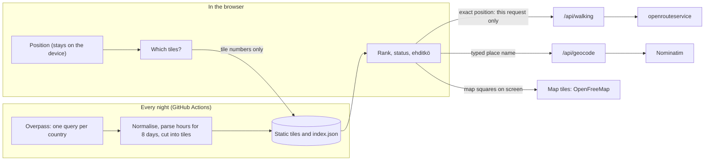

# Auki (working name)

A web app that finds the nearest open pharmacy, on a map and in a list, and says whether you get there before it closes. For someone in an unfamiliar city in the evening, with a prescription that may be from another country.

A job application project by Janne Lappi for Treat Health. Not a Treat product, and not affiliated with Treat Health.

**Live: <https://auki.vercel.app>**

> **To come, from Janne: a 30-second screen recording.** Its script is [`docs/recording.md`](docs/recording.md).

## If you have five minutes

**Try it, two minutes.** Open the live link on a phone. "In English" is at the top right.

1. Press "Näytä apteekit lähelläni" and allow the location, or press "Hae paikan nimellä" and type a place ("Kamppi").
2. The row at the bottom is the answer: the nearest open pharmacy, the walking minutes, its status. Pull the sheet up for the card. When that pharmacy closes within the hour, the card shows when you would be there, when it closes and the minutes to spare ("ehditkö").
3. Press the pharmacy's name: the route, the call, the medicine search, the week's hours.
4. Press the place name at the top and search "Riika". The card now says whether a prescription from your country works in Latvia, with its sources, and "Näytä apteekissa" opens a card for the counter, in Latvian.

**Read, three minutes.** "Three numbers" and "Decisions and trade-offs" below are what the project has to say for itself. The rest of this file is reference.

**Go deeper, if you like.** [`PLAN.md`](PLAN.md) is the spec. [`DESIGN-LOG.md`](DESIGN-LOG.md) has every design decision with its reason. Each piece of work was a pull request whose description is its report: what changed, why, screenshots, CI results and the measured numbers.

## Three numbers

| | Number | Where it is from |
|---|---|---|
| Time to first result on a throttled phone | **2.8 s** | The live site, 26 Nov 2026 |
| Opening hours read | **99.9 %** | The published data, 27 Nov 2026 |
| Initial JavaScript | **179 KB** | The live site, 27 Nov 2026 |

- **2.8 s** is from navigation to the first rendered result: Chromium on Lighthouse's phone profile (slow 4G, 4× slower CPU), location already allowed, nothing cached, from an invented position at Kamppi in Helsinki. Median of five runs (2.7 to 3.6 s): `node scripts/first-result-live.ts`. The list was by walking time in every run.
- **99.9 %**: of the 53,377 pharmacies that have opening hours in OpenStreetMap in the 31 countries covered, 53,349 were read into open intervals, and 28 were not. From the data host's [`index.json`](https://auki-data.vercel.app/tiles/v1/index.json); the same numbers per country are on the app's [data page](https://auki.vercel.app/fi/data).
- **179 KB**: the scripts of `/fi` as they travel, compressed by the host, in Lighthouse, median of three runs (178.5 KB; it was 174 KB on 25 Nov, and the budget is 185 KB). The same runs give a mobile LCP of 0.92 s. Nearly all of it is React and the Next.js runtime.

The number that limits the app is a fourth one: **43.6 %** of the 122,482 pharmacies in the 31 covered countries have opening hours in OpenStreetMap at all. The countries are those of the EU and the EEA, and Switzerland; France and the Netherlands mean their European parts. The number is from the data as published on 27 Nov 2026, the same `index.json`. It is 97 % in Luxembourg, 95 % in Norway, 92 % in Iceland, 82 % in Germany and 79 % in Finland, and 27 % in Ireland, 26 % in Romania, 23 % in Italy, 18 % in Spain, 10 % in Cyprus and 7 % in Greece. Where the hours are missing the app says "hours not listed" and never guesses.

In CI the same things are measured on every push, against a build and with fixtures, so that a change can't make them worse unnoticed. On `main` on 27 Nov 2026: time to first result 3.1 s on GitHub's runner, with a tile of 1,826 pharmacies, the weight of central Paris's, the heaviest real one (limit 5 s; with central Barcelona's 1,272, the heaviest until that day, the same runner measured 3.1 s too, and one Mac 0.08 s less); initial JavaScript 180.1 KB (budget 185 KB); mobile LCP 0.91 s (budget 2.5 s).

## What is in it

- **The first window** asks nothing. One button asks the browser for the position; another opens a search by place name. It is for a first visit: once that button has brought a position, later visits go straight to locating and the map.
- **Results, map first.** The nearest pharmacies as markers and as a list, sorted by walking time. Each has a status worked out on the device from the hours in the data, and renewed every minute: open, closes soon, closed and when it opens, hours not listed.
- **Ehditkö.** When the nearest open pharmacy closes within the hour, the card shows when you would be there, when it closes and the minutes to spare. When you would not make it, it says so and puts the next open one forward.
- **Nothing open nearby:** the app looks up to 30 km for one that is, and otherwise shows the first to open, with 112 kept in view.
- **A pharmacy's details**, opened from its name, its row or its marker: the name, the status and the walking time large; the route (handed off to Google Maps or Apple Maps), the call and the medicine search as one row of buttons; the week's opening hours, the phone number, and the website and email when OpenStreetMap has them; and a link to correct the data there.
- **A prescription from another country.** For anyone, in any covered country: where the prescription's country is not the pharmacy's, the card says whether the electronic prescription and the paper one work there. Each answer is what an official page said on the day it was read, with the page named and dated; where no page speaks, it says that nothing was found. The home country is the browser's own suggestion, changed in one control: nobody is asked. What a research trip met at each country's counters stands beside it, with its sample size, month and city, labelled as made with prescriptions from Finland. The research is in [`docs/research/prescriptions-across-borders.md`](docs/research/prescriptions-across-borders.md).
- **A card to show at the counter**, in the pharmacy's language with English under it, in twenty-four languages, one for each country: in Belgium and Luxembourg the card is in French. Twenty-two are drafts that no native speaker has read, and the card says so on its face. It asks only for what the answers above allow: no e-prescription lines where none works, and no card at all where the country's own authority says a paper prescription from there is not accepted.
- **Medicine availability, as a hand-off.** Where a country has a stock search of its own that may be linked to (Finland, Germany, Austria, Norway, and Iceland in Norway's form: a link to the page that says how to check), the card and every pharmacy's details open it from one of their main buttons, with the medicine's name in the link where the service's address takes one. The app says where to check, never that a pharmacy has a medicine, and the name never reaches the app's server. The research is in [`docs/research/medicine-availability.md`](docs/research/medicine-availability.md).
- **Visitors' reports.** A row in a pharmacy's details offers to tell how a visit went: one screen of chips, no text, always skippable, never asked. Anonymous, and shown for a pharmacy only once it has three, as facts with their count and days ("English was spoken, 4 of 5 visits"). Two filters over the list, off until pressed, keep the pharmacies where visitors said English was spoken or the way in was step-free. Reports never change the order, and none is invented: with too few, the app says so (`PLAN.md` section 7.10).
- **A data page** with the pipeline's numbers per country, and when each was last fetched.
- **Finnish and English**, light and dark, phone and desktop, in the device's own typeface: no font is fetched.
- **An iOS app** (`ios/`): SwiftUI and Apple's map on the same data, with the first window, the map, and a sheet with the nearest open pharmacy and the list. A pharmacy has a sheet of its own with the week's opening hours, the call and the route handed off to Apple Maps. Its time logic passes the same test cases as the web's (`tests/vectors/`). No walking times and no route line on its own map yet. Built and run in the Simulator; its tests run locally, not in CI. See [`ios/README.md`](ios/README.md).

Every view and state can be seen from fixtures, without a network, at `/dev/states` in a development build.

## How it is built

Three parts:

- **A nightly data pipeline** (GitHub Actions) turns OpenStreetMap's pharmacies into small static files, the tiles. Nothing in the app queries OpenStreetMap's servers.
- **A static site** (Next.js) that reads the tiles. Ranking, opening status and ehditkö all run in the browser, from the position on the device.
- **Two thin server routes** for what can't be worked out ahead: walking times (openrouteservice) and place search (Nominatim).



TypeScript throughout, CSS Modules with CSS variables, no UI kit, no analytics, no cookies, no database. The map is MapLibre with the app's own style on OpenFreeMap's vector tiles.

## Decisions and trade-offs

**Static tiles instead of live queries.** The first plan asked OpenStreetMap's Overpass servers from the user's request. They are shared, sometimes down for an afternoon, and say of themselves that they are meant for human-operated tools. So a nightly job asks once per country and writes one small file per square of 20 to 30 km. Measured on the run of 23 Nov 2026, for the 21 countries covered then: 5,012 files, 5.0 MB gzipped in all, a median of 0.6 KB each and 54 KB for the largest (central Barcelona, 1,272 pharmacies). The ten countries that joined on 27 Nov 2026, measured alone in a local run: 2,216 tile files, 1,782 KB gzipped in all, the same median, and a new largest tile, central Paris with 1,826 pharmacies and 67.6 KB (72.1 KB as the CDN sends it to a browser: it compresses on the way, and lighter). On a throttled phone that tile costs about 0.08 s more than Barcelona's, so no square is split. The site of all 31 countries has not been built in one run, so its totals are not measured. The app is then as fast and as available as a static file. The cost: the data is up to a day old, and a country whose query fails keeps the night before's. Data older than seven days is never shown as open.

**Opening hours parsed in the pipeline, not on the phone.** OpenStreetMap's `opening_hours` is a small language with public holidays in it. The pipeline turns each value into plain open intervals for the next eight days, in the pharmacy's own time zone, with the country's holidays. The browser then needs no parser and no holiday tables: "open now" is a comparison of numbers. The cost is those eight days, which is why a tile expires.

**The position leaves the device in one request.** Finding pharmacies sends no position: the requests name squares. Walking times can't be worked out ahead, so `POST /api/walking` carries the position, in its body, to the app's own server, which asks openrouteservice; openrouteservice sees the server, not the user, and nothing is logged. A browser test records every request of the whole flow and fails if any other request carries the position, or if one goes to a host other than the app's and the map tile host. The Content-Security-Policy is built from the same list (`lib/requests.ts`). The map tile host learns which map squares are on screen: it is the one third party.

**The straight-line fallback.** Walking times come from openrouteservice's free plan, 500 searches a day. The server keeps its own count under that and stops asking for a while when the service says no or keeps failing. The list waits a second and a half for walking times and no longer: without them it is by straight line and says so, and it is never reordered afterwards. A walking service that is down costs the first few users that second and a half, and the rest nothing.

**What the corpus showed.** Every distinct `opening_hours` value of a real run is pinned in the repository (`data/corpus/`) and parsed in CI, so a change to the parsing shows up as a diff of counts per country. Of the values that exist, 99.9 % can be read. What can't be helped by parsing is that most pharmacies in Southern Europe have no hours in OpenStreetMap at all. Where most of the nearest ones have none, the card leads with the nearest pharmacy, says what isn't known and puts the call first, instead of sending people past seven pharmacies to a far one whose hours happen to be listed.

**The map is the heaviest thing, so nothing waits for it.** MapLibre and its worker are 439 KB as they travel, against 174 KB for the first window. They are fetched only once the results are on screen, with a budget of their own in CI. The markers are the app's own buttons over the map, placed by the same arithmetic with MapLibre or without it: when the map can't be drawn, the markers and the list go on working, and the app says what is missing.

**Time is the part most likely to be wrong, so it has the most tests.** Midnight crossings, both daylight-saving changes in every covered zone, public holidays and the boundaries of ehditkö are property tests. Their cases are also saved as files that the iOS app is checked against.

## Privacy

- No accounts, no cookies, no analytics, and no position is kept on any server. The device keeps four things: the three here, and one for the visitors' reports, below. One mark, that location has worked here before, so that a later visit skips the first window: one character, with no position and no time in it. The country of the prescription, once it has been picked in the "Resepti kotimaasta?" banner: two letters, read on the device and never sent. And each tab keeps its own last search, the position with it, so that the results are there again when the tab is loaded anew: in the tab's session storage, never sent anywhere, gone when the tab is closed or the results are left, and not used once it is half an hour old.
- The position: one request, to the app's own server, as above. Checked by a test on every push.
- A medicine's name: typed into a field that belongs to no form, kept only while the dialog is open, and sent only in the link the user opens, to the service that link names. Checked by a second test.
- Links out (map apps, phone, a pharmacy's website) carry the pharmacy's position or nothing, and no referrer.
- A visitor's report: sent only when the user presses "Lähetä", and it carries the pharmacy, its country and the chips pressed, to the letter; with a chip about the prescription, also a yes or no to whether it was from another country, never which. Stored with the day and nothing else: no account, no position, no medicine, no text, no time of day, no IP address. Shown for a pharmacy only once it has three, as counts with the days. The database is behind the app's own server, with row-level security on and no policy; the browser never talks to it. Checked by a third test, and by a unit test that reads the table's columns from the migration.
- For the reports the device keeps the fourth thing: today's date and the ids of the pharmacies whose row was answered or passed over today, so that the same visit is not asked about twice. Never sent, and empty again the next day.

## Accessibility

Checked on every push, on every view of `/dev/states`:

- **axe**, in both themes, at both sizes, in Chromium and WebKit: WCAG 2.0, 2.1 and 2.2 at A and AA, and axe's best practices. No rule is off and no view is left out.
- **The keyboard alone**, in both browsers: the first window, the position, the results, the phone sheet's three places, a pharmacy's details and back, another place by its name, the counter card. Wherever it stops, and in Chromium on every view: Tab reaches every control that shows, and whatever has the focus can be seen.
- **Reflow:** at 320 px wide (both browsers) and at 200 % zoom (Chromium) nothing scrolls sideways and no text or control is cut off.

What the first run of these found, and what was changed, is in `DESIGN-LOG.md` under 25 and 26 Nov 2026: 506 controls whose name did not contain the text they show, markers the keyboard reached under the phone's open list, a map that Chromium scrolled out of place, a line that was cut off at 320 px.

The last finding was the map's markers. A marker stands where its pharmacy is, so some marker always lies half under the bar, the sheet or another marker, with a sliver left to press. WCAG excepts pins on a map from its target size, and the app does not use the exception: a marker is offered as a button only where 24 by 24 px of it are free. One that the bar, the sheet or the map's edge covers is taken off the map, and an open pharmacy then has a chip on the map's edge, with its walking time and an arrow. One in a pile of signs stays drawn and is no button until a pinch gives it room. Every pharmacy is a row of the list either way.

Status is never told by colour alone: the cross has four shapes. The list is the map's equivalent, and comes first in the tab order.

> **To come, from Janne: the VoiceOver pass**, on macOS and on an iPhone, logged here with its date and what it found.

## How it was made

Built between 22 and 27 Nov 2026 by Janne Lappi with Claude Code. Janne wrote the brief, tried each version on his phone and made the decisions; Claude Code wrote the code, the tests and the reports, from the spec in [`PLAN.md`](PLAN.md) and the working rules in [`CLAUDE.md`](CLAUDE.md). Every change came as a pull request that Janne reviewed and merged, or had said beforehand could be merged once its checks were green. [`DESIGN-LOG.md`](DESIGN-LOG.md) says of each design decision whose it was.

## Left out, and why

**Not built yet (milestone M6).** These are in the plan and not in the app:

- The duty-pharmacy lookup for countries where night duty rotates.
- The hand-off link another app could open with the country and the prescription's format preset (`PLAN.md` section 7.8). Nothing reads such a link today.
- Offline use for the area searched last.
- The page that lists every request the app makes. The list itself is `PLAN.md` section 7.6 and `lib/requests.ts`.

**Left out on purpose** (`PLAN.md` section 4):

- The app's own medicine stock or price data: there is no source for it. For stock the app hands over to each country's own service.
- Doctor, chat or triage: that is Treat's product, not this app's.
- Reviews or ratings from Google on the map: Google's terms for the EEA don't allow its Places content with someone else's map. The app links to Google Maps instead.
- Storing prescriptions or identity numbers. Accounts, any LLM feature, push notifications. A database for anything but the visitors' reports: the pharmacies are static files.
- Claims about what a single pharmacy can do with a foreign prescription: the field samples are too small, and the answer depended on who stood at the counter.

## Known limitations

- **Opening hours are only as good as OpenStreetMap's**, and in Southern Europe most pharmacies have none there yet (the numbers above).
- **In a public repository GitHub switches scheduled workflows off after 60 days without a commit.** The data would then age, and after seven days the app shows no pharmacy as open. "Enable workflow" on the Data workflow's page switches it back on.
- **Public holidays** are known per country, and per state or canton in Germany, Spain and Switzerland. A town's own holidays, common in Spain and Italy, are not. The hours library has no holidays for Cyprus, Iceland and Liechtenstein: hours that mention them are not read there, and never shown as open or closed. For France it lacks 1 January, so French hours that mention holidays are shown as uncertain from 25 December to 1 January.
- **France and the Netherlands are their European parts.** Pharmacies in France's overseas departments and territories and in the Caribbean parts of the Netherlands are left out: 756 of them on 27 Nov 2026. They keep other clocks, and a country has one time zone here. Cyprus is the whole island.
- **Greek place names.** OpenStreetMap writes a city in the local script. A city in Greek letters that is not in the app's small table of Finnish and English names is not shown: the app says "Lähelläsi" (near you) instead.
- **The public Overpass servers are shared and sometimes busy.** The pipeline asks once per country, retries once, tries one other server, and otherwise keeps the night before's data; a second pass at the end of the same run, and another attempt two and a half hours later, ask again for the countries that failed. A commercial service should build from a planet extract or its own Overpass instance.
- **Walking times depend on a free plan** of 500 searches a day. Beyond that, and whenever the service is slow, distances are straight lines, labelled as such. The budget is counted in the server's memory, per instance.
- **The limits on visitors' reports count calls, not callers.** Nothing about the sender is read or stored (no account, no IP address), so the app can't tell two visitors from one. One script could send a pharmacy's 20 reports a day itself, all invented, and from three reports on they are shown as counts. It could also use up the 2,000 the database takes in a day in all, and then no report is taken for any pharmacy until the next day. This is kept on purpose: counting per person would mean reading who sends. What stands against it today is small: the summary says "Nimettömiä, ei tarkistettuja" (anonymous and not verified), a pharmacy's day is capped, and the trip's field findings are kept apart from the reports. What would fix it later is a rate limit per address at the platform's edge (on Vercel, a firewall rule for `/api/report`): the edge sees every request's address anyway, and would count and refuse there, so that no address reaches the app's code or the database.
- **The map needs WebGL.** Without it the markers stand on a plain ground and the app says so.
- **Hours written as sunrise or sunset** are shown as uncertain.
- **Landscape phones** get the phone layout and are cramped.
- **The first window's sky** takes its place from the device's time zone, so it is approximate by design: no location is asked for it.
- **The name is not decided.** It lives in one constant, `lib/brand.ts`, and one line of `ios/Brand.xcconfig`.

## Open pull requests

This file describes what is in `main`. On 27 Nov 2026 no pull request is open that is not described above.

## Run it

```
npm install
npm run dev
```

Then open `/fi` or `/en`, and `/dev/states` for every view and state in light and dark, phone and desktop. Node 22.18 or later.

- Place search needs `CONTACT_EMAIL` in `.env.local` (Nominatim asks callers to identify themselves), and walking times need `ORS_API_KEY`, a free key from openrouteservice. Copy `.env.example`. Without them the app works: by straight line, and without the search.
- Visitors' reports need a Supabase project: `SUPABASE_URL` and `SUPABASE_SECRET_KEY` in `.env.local`, and `npm run db:push` with `SUPABASE_DB_URL` (it needs the Supabase CLI) once, and again whenever `supabase/migrations/` has a new file. Without them the app offers no report and shows none.
- Real pharmacies in development: `npm run data` once (it needs `CONTACT_EMAIL`), then `npm run data:serve` next to the dev server.
- Tests: `npm test` (unit and property tests), `npm run test:e2e` (Playwright, Chromium and WebKit), `npm run lighthouse` (the budgets, against a build).
- The other commands are listed in `CLAUDE.md`.

## Where things are

| | |
|---|---|
| `app/`, `components/`, `hooks/` | The pages, the views and their state |
| `lib/` | The logic, pure where it can be: tiles, opening status, ehditkö, the map's arithmetic, formats, the two languages |
| `lib/server/`, `app/api/` | The three server routes: place search, walking times, visitors' reports |
| `supabase/migrations/` | The reports table and its two functions |
| `pipeline/` | The nightly data pipeline |
| `tests/` | Unit and property tests, the Playwright tests with their visual baselines, and the shared cases for the iOS app |
| `ios/` | The iOS app |
| `docs/` | The tile format, and the research behind the plan |
| `design/` | The approved visual direction and the screenshots of each pull request |

## Data and credits

- Pharmacies: © OpenStreetMap contributors, under the ODbL. Wrong or missing data is corrected in OpenStreetMap, and shows in the app after the next night.
- Map tiles: OpenFreeMap, on the OpenMapTiles schema. `NEXT_PUBLIC_MAP_TILES_URL` points the same style at another host with that schema.
- Walking times and routes: openrouteservice. Place search: Nominatim.
- Typeface: the device's own (SF Pro on Apple devices, Roboto on Android). No font file is served or fetched, and the map draws its street names in the same typeface.
- The field findings behind the plan are from Treat Health's research trip of November 2026, used with permission: [`docs/research/pharmacy-field-findings.md`](docs/research/pharmacy-field-findings.md).
