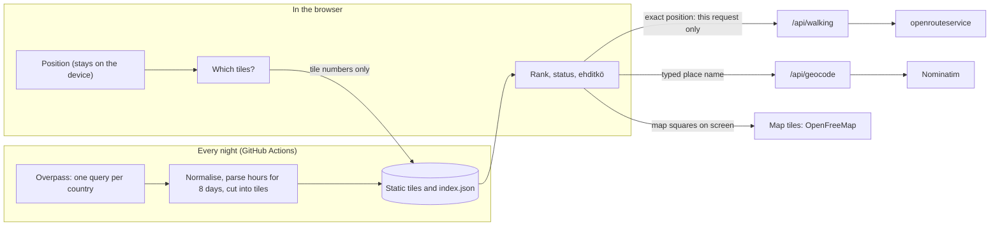

# Auki (working name)

A web app that finds the nearest open pharmacy, on a map and in a list, and says whether you get there before it closes. A job application project by Janne Lappi for Treat Health. Not a Treat product, and not affiliated with Treat Health.

**Live: <https://auki.vercel.app>**

> **To come, from Janne: a 30-second screen recording.** Open, allow location, the nearest open pharmacy, ehditkö, the route hand-off.

The spec is [`PLAN.md`](PLAN.md), the working rules are in [`CLAUDE.md`](CLAUDE.md), and every design decision made during the build is in [`DESIGN-LOG.md`](DESIGN-LOG.md). Each milestone was a pull request whose description is its report: what changed, why, screenshots, CI results and the measured numbers.

## Three numbers

| | Number | Measured |
|---|---|---|
| Time to first result on a throttled phone | **2.5 s** | 25 Nov 2026, on the live site. Chromium on Lighthouse's phone profile (slow 4G, 4× slower CPU), location already allowed, nothing cached, from navigation to the first rendered result, from an invented position at Kamppi in Helsinki. Median of five runs (2.5 to 3.4 s): `node scripts/first-result-live.ts`. The list was by straight line: that day the live site's walking service answered with an error after half a second (see "Open pull requests"). With walking times the list waits for them, for a second and a half at the most. |
| Opening hours read | **99.9 %** | 25 Nov 2026, from the live data host's [`index.json`](https://auki-data.vercel.app/tiles/v1/index.json), as the night's pipeline run wrote it: of the 38,089 pharmacies that have opening hours in OpenStreetMap, 38,067 were read into open intervals. The same numbers per country are on the app's [data page](https://auki.vercel.app/fi/data). |
| Initial JavaScript | **174 KB** | 25 Nov 2026, on the live site: the scripts of `/fi` as they travel, compressed by the host, in Lighthouse, median of three runs. The same runs give a mobile LCP of 0.91 s on Lighthouse's phone profile. Nearly all of it is React and the Next.js runtime. |

The number that limits the app is a fourth one: **42.3 %** of the 89,988 pharmacies in the 21 covered countries have opening hours in OpenStreetMap at all. It is 95 % in Norway, 82 % in Germany and 79 % in Finland, and 23 % in Italy, 18 % in Spain and 7 % in Greece. Where the hours are missing the app says "hours not listed" and never guesses.

In CI the same things are measured on every push, against a build and with fixtures, so that a change can't make them worse unnoticed. On `main` on 25 Nov 2026: time to first result 4.5 s on GitHub's runner, with a tile as heavy as the heaviest real one (central Barcelona, 1,272 pharmacies; limit 5 s); initial JavaScript 176.6 KB (budget 185 KB); mobile LCP 0.93 s (budget 2.5 s).

## What is in it

- **The first window** asks nothing. One button asks the browser for the position; another opens a search by place name.
- **Results, map first.** The nearest pharmacies as markers and as a list, sorted by walking time. Each has a status worked out on the device from the hours in the data, and renewed every minute: open, closes soon, closed and when it opens, hours not listed.
- **Ehditkö.** When the nearest open pharmacy closes within the hour, the card shows when you would be there, when it closes and the minutes to spare. When you would not make it, it says so and puts the next open one forward.
- **Nothing open nearby:** the app looks up to 30 km for one that is, and otherwise shows the first to open, with 112 kept in view.
- **A pharmacy's details:** the week's opening hours, a route handed off to Google Maps or Apple Maps, the phone number, the website and email when OpenStreetMap has them, and a link to correct the data there.
- **Medicine availability, as a hand-off.** Where a country has a stock search of its own that may be linked to (Finland, Germany, Austria, Norway), the card and every pharmacy's details open it, with the medicine's name in the link where the service's address takes one. The app says where to check, never that a pharmacy has a medicine, and the name never reaches the app's server. The research is in [`docs/research/medicine-availability.md`](docs/research/medicine-availability.md).
- **A data page** with the pipeline's numbers per country, and when each was last fetched.
- **Finnish and English**, light and dark, phone and desktop.
- **An iOS app** (`ios/`): SwiftUI and Apple's map on the same data, with the first window, the map, and a sheet with the nearest open pharmacy and the list. Its time logic passes the same test cases as the web's (`tests/vectors/`). No pharmacy details, walking times or route yet. Built and run in the Simulator; its tests run locally, not in CI. See [`ios/README.md`](ios/README.md).

Every view and state can be seen from fixtures, without a network, at `/dev/states` in a development build.

## How it is built

Three parts:

- **A nightly data pipeline** (GitHub Actions) turns OpenStreetMap's pharmacies into small static files, the tiles. Nothing in the app queries OpenStreetMap's servers.
- **A static site** (Next.js) that reads the tiles. Ranking, opening status and ehditkö all run in the browser, from the position on the device.
- **Two thin server routes** for what can't be worked out ahead: walking times (openrouteservice) and place search (Nominatim).



TypeScript throughout, CSS Modules with CSS variables, no UI kit, no analytics, no cookies, no database. The map is MapLibre with the app's own style on OpenFreeMap's vector tiles.

## Decisions and trade-offs

**Static tiles instead of live queries.** The first plan asked OpenStreetMap's Overpass servers from the user's request. They are shared, sometimes down for an afternoon, and say of themselves that they are meant for human-operated tools. So a nightly job asks once per country and writes one small file per square of 20 to 30 km. Measured on the run of 23 Nov 2026: 5,012 files, 5.0 MB gzipped in all, a median of 0.6 KB each and 54 KB for the largest (central Barcelona, 1,272 pharmacies). The app is then as fast and as available as a static file. The cost: the data is up to a day old, and a country whose query fails keeps the night before's. Data older than seven days is never shown as open.

**Opening hours parsed in the pipeline, not on the phone.** OpenStreetMap's `opening_hours` is a small language with public holidays in it. The pipeline turns each value into plain open intervals for the next eight days, in the pharmacy's own time zone, with the country's holidays. The browser then needs no parser and no holiday tables: "open now" is a comparison of numbers. The cost is those eight days, which is why a tile expires.

**The position leaves the device in one request.** Finding pharmacies sends no position: the requests name squares. Walking times can't be worked out ahead, so `POST /api/walking` carries the position, in its body, to the app's own server, which asks openrouteservice; openrouteservice sees the server, not the user, and nothing is logged. A browser test records every request of the whole flow and fails if any other request carries the position, or if one goes to a host other than the app's and the map tile host. The Content-Security-Policy is built from the same list (`lib/requests.ts`). The map tile host learns which map squares are on screen: it is the one third party.

**The straight-line fallback.** Walking times come from openrouteservice's free plan, 500 searches a day. The server keeps its own count under that and stops asking for a while when the service says no or keeps failing. The list waits a second and a half for walking times and no longer: without them it is by straight line and says so, and it is never reordered afterwards. A walking service that is down costs the first few users that second and a half, and the rest nothing.

**What the corpus showed.** Every distinct `opening_hours` value of a real run is pinned in the repository (`data/corpus/`) and parsed in CI, so a change to the parsing shows up as a diff of counts per country. Of the values that exist, 99.9 % can be read. What can't be helped by parsing is that most pharmacies in Southern Europe have no hours in OpenStreetMap at all. Where most of the nearest ones have none, the card leads with the nearest pharmacy, says what isn't known and puts the call first, instead of sending people past seven pharmacies to a far one whose hours happen to be listed.

**The map is the heaviest thing, so nothing waits for it.** MapLibre and its worker are 439 KB as they travel, against 174 KB for the first window. They are fetched only once the results are on screen, with a budget of their own in CI. The markers are the app's own buttons over the map, placed by the same arithmetic with MapLibre or without it: when the map can't be drawn, the markers and the list go on working, and the app says what is missing.

**Time is the part most likely to be wrong, so it has the most tests.** Midnight crossings, both daylight-saving changes in every covered zone, public holidays and the boundaries of ehditkö are property tests. Their cases are also saved as files that the iOS app is checked against.

## Privacy

- No accounts, no cookies, no analytics, and nothing about the position is stored.
- The position: one request, to the app's own server, as above. Checked by a test on every push.
- A medicine's name: typed into a field that belongs to no form, kept only while the dialog is open, and sent only in the link the user opens, to the service that link names. Checked by a second test.
- Links out (map apps, phone, a pharmacy's website) carry the pharmacy's position or nothing, and no referrer.

## Accessibility

Checked on every push, on every view of `/dev/states`:

- **axe**, in both themes, at both sizes, in Chromium and WebKit: WCAG 2.0, 2.1 and 2.2 at A and AA, and axe's best practices. No rule is off and no view is left out.
- **The keyboard alone**, in both browsers: the first window, the position, the results, the phone sheet's three places, a pharmacy's details and back, another place by its name, the counter card. Wherever it stops, and in Chromium on every view: Tab reaches every control that shows, and whatever has the focus can be seen.
- **Reflow:** at 320 px wide (both browsers) and at 200 % zoom (Chromium) nothing scrolls sideways and no text or control is cut off.

What the first run of these found, and what was changed, is in `DESIGN-LOG.md` under 25 Nov 2026: 506 controls whose name did not contain the text they show, markers the keyboard reached under the phone's open list, a map that Chromium scrolled out of place, a line that was cut off at 320 px.

One finding is left standing on purpose. In eight phone views axe reports a map marker that lies partly under the bar or the sheet's handle as too small a target. A marker stands where its pharmacy is, and the list has the same pharmacy at full size: the criterion (WCAG 2.5.8) excepts both. Those tests fail until it is decided how to record that.

Status is never told by colour alone: the cross has four shapes. The list is the map's equivalent, and comes first in the tab order.

> **To come, from Janne: the VoiceOver pass**, on macOS and on an iPhone, logged here with its date and what it found.

## Left out, and why

**Not built yet (milestone M6).** These are in the plan and not in the app:

- Abroad: the "Resepti Suomesta?" banner with the field result for the country, and the counter card in the local language. Both exist as views on example data in `/dev/states`; the live app does not show them.
- The duty-pharmacy lookup for countries where night duty rotates.
- The hand-off link another app could open with the country and the prescription's format preset (`PLAN.md` section 7.8). Nothing reads such a link today.
- Offline use for the area searched last.
- The page that lists every request the app makes. The list itself is `PLAN.md` section 7.6 and `lib/requests.ts`.

**Left out on purpose** (`PLAN.md` section 4):

- The app's own medicine stock or price data: there is no source for it. For stock the app hands over to each country's own service.
- Doctor, chat or triage: that is Treat's product, not this app's.
- Reviews or ratings from Google on the map: Google's terms for the EEA don't allow its Places content with someone else's map. The app links to Google Maps instead.
- Storing prescriptions or identity numbers. Accounts, a database, any LLM feature, push notifications.
- Claims about what a single pharmacy can do with a foreign prescription: the field samples are too small, and the answer depended on who stood at the counter.

## Known limitations

- **Opening hours are only as good as OpenStreetMap's**, and in Southern Europe most pharmacies have none there yet (the numbers above).
- **In a public repository GitHub switches scheduled workflows off after 60 days without a commit.** The data would then age, and after seven days the app shows no pharmacy as open. "Enable workflow" on the Data workflow's page switches it back on.
- **Public holidays** are known per country, and per state or canton in Germany, Spain and Switzerland. A town's own holidays, common in Spain and Italy, are not.
- **Greek place names.** OpenStreetMap writes a city in the local script. A city in Greek letters that is not in the app's small table of Finnish and English names is not shown: the app says "Lähelläsi" (near you) instead. The typeface has no Greek either.
- **The public Overpass servers are shared and sometimes busy.** The pipeline asks once per country, retries once, tries one other server, and otherwise keeps the night before's data; a second attempt two and a half hours later asks again for the countries that failed. A commercial service should build from a planet extract or its own Overpass instance.
- **Walking times depend on a free plan** of 500 searches a day. Beyond that, and whenever the service is slow, distances are straight lines, labelled as such. The budget is counted in the server's memory, per instance.
- **The map needs WebGL.** Without it the markers stand on a plain ground and the app says so.
- **Hours written as sunrise or sunset** are shown as uncertain.
- **Landscape phones** get the phone layout and are cramped.
- **The first window's sky** takes its place from the device's time zone, so it is approximate by design: no location is asked for it.
- **The name is not decided.** It lives in one constant, `lib/brand.ts`, and one line of `ios/Brand.xcconfig`.

## Open pull requests

This file describes what is in `main`. Open on 25 Nov 2026, and not described above:

- [#13](https://github.com/Tilapit/auki/pull/13), the iOS app's basics: a pharmacy's sheet with its hours, the call and the route.
- [#14](https://github.com/Tilapit/auki/pull/14), walking times work again: openrouteservice's address changed on 24 Nov. Until it is merged and deployed, the live site's distances are straight lines.
- [#15](https://github.com/Tilapit/auki/pull/15), the iPhone findings of 25 Nov: the pharmacy's details as a place card, markers that don't pile up, lost touches, the screen's edges.

## Run it

```
npm install
npm run dev
```

Then open `/fi` or `/en`, and `/dev/states` for every view and state in light and dark, phone and desktop. Node 22.18 or later.

- Place search needs `CONTACT_EMAIL` in `.env.local` (Nominatim asks callers to identify themselves), and walking times need `ORS_API_KEY`, a free key from openrouteservice. Copy `.env.example`. Without them the app works: by straight line, and without the search.
- Real pharmacies in development: `npm run data` once (it needs `CONTACT_EMAIL`), then `npm run data:serve` next to the dev server.
- Tests: `npm test` (unit and property tests), `npm run test:e2e` (Playwright, Chromium and WebKit), `npm run lighthouse` (the budgets, against a build).
- The other commands are listed in `CLAUDE.md`.

## Where things are

| | |
|---|---|
| `app/`, `components/`, `hooks/` | The pages, the views and their state |
| `lib/` | The logic, pure where it can be: tiles, opening status, ehditkö, the map's arithmetic, formats, the two languages |
| `lib/server/`, `app/api/` | The two server routes |
| `pipeline/` | The nightly data pipeline |
| `tests/` | Unit and property tests, the Playwright tests with their visual baselines, and the shared cases for the iOS app |
| `ios/` | The iOS app |
| `docs/` | The tile format, and the research behind the plan |
| `design/` | The approved visual direction and the screenshots of each pull request |

## Data and credits

- Pharmacies: © OpenStreetMap contributors, under the ODbL. Wrong or missing data is corrected in OpenStreetMap, and shows in the app after the next night.
- Map tiles: OpenFreeMap, on the OpenMapTiles schema. `NEXT_PUBLIC_MAP_TILES_URL` points the same style at another host with that schema.
- Walking times and routes: openrouteservice. Place search: Nominatim.
- Typeface: Atkinson Hyperlegible Next, served from the app's own origin.
- The field findings behind the plan are from Treat Health's research trip of November 2026, used with permission: [`docs/research/pharmacy-field-findings.md`](docs/research/pharmacy-field-findings.md).
